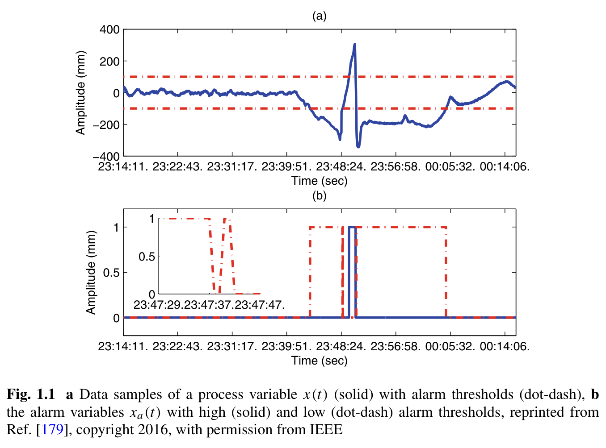
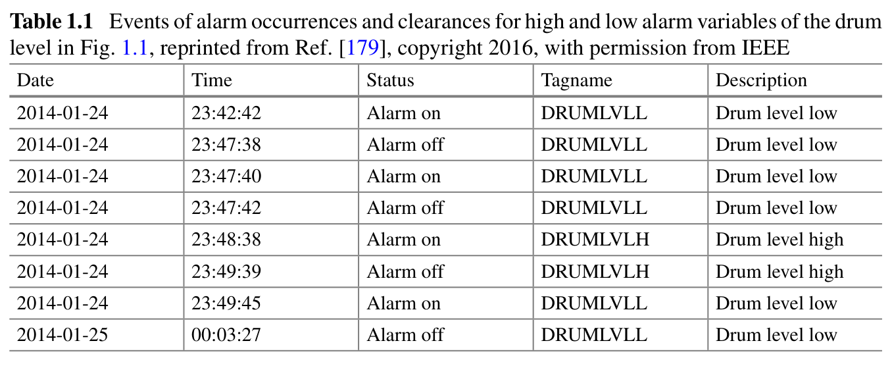
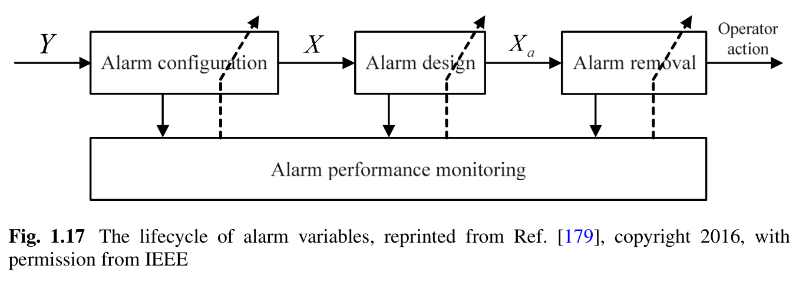

# 第 1 章：工业报警系统概述

原文：[参考 PDF](../references/source.pdf)，书页 1–47，PDF 第 13–59 页。
查阅位置：§1.1 PDF 13；§1.2 PDF 19；§1.3 PDF 32；§1.4 PDF 40。

本篇配图目录：`references/figures/1/`（相对 Skill 根目录）。`1.png`、`2.png`、`3.png` 按本篇出现顺序编号，与原书图表号分别标注；可从 PyCharm 项目文件树直接打开。

## 核心思路

工业报警把大量过程测量转换成操作员能够关注和处理的状态与事件。全书围绕报警过载的成因，分别研究报警的配置、生成机制、发生后的分析与处理；不是只研究一个统一的“异常检测器”。

## 先认清三个对象

**过程变量 x(t)** 是带采样周期的连续测量，如水位、压力。**报警变量 xa(t)** 表示某个已配置报警的二值状态。**报警事件** 是状态转换的记录，0→1 为发生，1→0 为解除，通常有 Tag、时间和描述。

阈值比较是基本的报警生成机制。对于高报警，测量达到高限可令 xa=1；这定义了报警状态，不自动证明对应物理过程确实异常。噪声、配置不当或忽略相关关系，都可能让报警与需要操作员处理的异常不一致。

## 汽包水位例子：测量、状态和事件怎样对应

§1.1 用汽包水位（drum level）说明上面三个对象。先看原书图 1.1：

本篇图片 **1**（`1.png`）。来源：[原书 PDF](../references/source.pdf) 第 14 页（书页 2），Fig. 1.1；图片保留原图及出处说明。

- **上图 (a) 是测量值**：蓝色实线是水位随时间的变化，单位为 mm；红色点划线是 +100 mm 和 −100 mm 两个报警阈值。这里的水位数值表示相对基准的高低。
- **下图 (b) 是报警状态**：蓝色实线表示高报警，红色点划线表示低报警，取值只有 0 和 1。水位超过 +100 mm 时高报警为 1；低于 −100 mm 时低报警为 1；在两条限值之间，两者都为 0。虽然原图下半部分的纵轴仍印着 “Amplitude (mm)”，这里应按二值状态读，不能当成水位。
- **左上角小窗是局部放大**：23:47:38 低报警解除，23:47:40 又发生，23:47:42 再解除。主图时间跨度较大，不放大就很难看到这些短时切换。

再看这些状态变化如何记进日志：

本篇图片 **2**（`2.png`）。来源：[原书 PDF](../references/source.pdf) 第 15 页（书页 3），Table 1.1。`DRUMLVLL` 是低水位报警，`DRUMLVLH` 是高水位报警；`Alarm on` 对应 0→1，`Alarm off` 对应 1→0。

例如，23:42:42 低报警发生，直到 23:47:38 才解除。在这段时间内，低报警状态持续为 1，日志记录的是发生、解除两个事件，并非每秒都新增一次报警事件。前一张图小窗中的三次切换，对应表中 23:47:38、23:47:40 和 23:47:42 三行。

因此，一条水位时序可以生成两条报警状态序列，再从状态的跳变形成事件日志。这个例子展示的是最基本的阈值报警机制；它没有提供独立标注的真实异常标签，不能直接把这些报警状态当成评估误报、漏报的 Ground Truth。书中 near miss 指偏离并随后返回正常运行范围的情形；报警给操作员留下干预机会。

## 为什么会报警过载

§1.2 提出四类主要原因：

1. **噪声和扰动**：阈值附近反复切换，形成 chattering/repeating alarms。
2. **报警变量配置不当**：重复、关联或没有明确处置意义的通知增加负担。
3. **独立设计忽略变量关系**：各变量在自己的固定范围内，联合状态仍可能不正常；反过来也可能产生无效单点报警。
4. **异常沿物理连接传播**：一次异常在多个测点触发后续报警，形成难以辨认源头的报警集合或洪泛。

减少报警量并非唯一目标。系统需要兼顾安全、效率、可理解性和操作员响应能力；无意义的重复报警会削弱信任，遗漏重要报警也会削弱系统功能。

## 三个阶段怎样连起来

§1.4 的 Fig.1.17（PDF 41）是阅读全书的重要入口：

本篇图片 **3**（`3.png`）。来源：[原书 PDF](../references/source.pdf) 第 41 页（书页 29），Fig. 1.17；图片保留原图及出处说明。

沿主箭头读：全部候选过程变量 **Y** → 配置阶段选出需要设置报警的变量 **X** → 设计阶段生成对应报警变量 **Xa** → 报警发生后确定操作员行动。下方的 **Alarm performance monitoring** 同时连接三个阶段，表示各阶段都需要监测表现并反馈改进。

| 阶段 | 书中关注的问题 | 与后文的联系 |
|---|---|---|
| Alarm configuration | 从候选过程变量中选择哪些应配置报警，确定优先级，检查错误配置 | 先明确报警对应什么事件和操作意义 |
| Alarm design | 为选定变量设计报警生成机制及参数，监测其表现 | 第 2、3 章 |
| Alarm removal | 报警发生后查找根因、决定操作行动，消除异常 | 第 4、5 章及第 6 章响应分析 |

这里的 removal 涉及报警对应异常的处理，不能仅理解为关闭显示或从数据库删除报警。

书中另介绍工业报警管理生命周期，但上述三个研究阶段是围绕报警变量组织问题，两种划分的用途不同。

## 八个研究问题的阅读线索

书中依次讨论：给定过程变量是否应配置报警；应赋什么优先级；已有系统中是否有错误配置；报警机制性能是否合格；如何减少干扰报警；能否更早预警；如何确定根因；应采取什么动作。

它们提醒读者：选测点、优化阈值、定位根因是相互关联而目标不同的工作。只改善一个检测分数，不足以说明其他问题已经解决。

## 阅读时抓住的关系

- 优先级需要考虑后果和允许处置时间，不由报警频次单独决定。
- 频繁报警是排查入口，不代表它一定是错误报警；低频也不代表低风险。
- 同步或相继报警提示关系，是否冗余、是否同一源头仍需过程知识。
- 正常状态不总是各变量独立区间的笛卡尔积；第 3 章用联合特征表达这种差异。
- 本章的工业例子与统计数字有具体场景，不能直接成为所有工厂统一的验收值。

## 继续查阅

关心一支测点的阈值、延时、死区，读 [第 2 章](ch02-univariate-alarm-design.md)。关心相关变量关系，读 [第 3 章](ch03-multivariate-alarm-design.md)。关心一次异常带来的报警传播，读 [第 4 章](ch04-root-cause-analysis.md) 和 [第 5 章](ch05-alarm-floods.md)。日志结构和操作员响应可视化见 [第 6 章](ch06-visual-analytics.md)。
