# 第 2 章：单变量报警系统优化设计

原文：[参考 PDF](../references/source.pdf)，书页 49–127，PDF 第 60–138 页。
入口：§2.1 PDF 60；参考数据构造 PDF 70；§2.2 PDF 79；§2.3 PDF 96；§2.4 PDF 119。
图片位于 `references/figures/2/`，按出现顺序为 `1.png` 至 `13.png`；Gateway 不显示时，在项目文件树中打开 PNG。

## 这一章要做什么

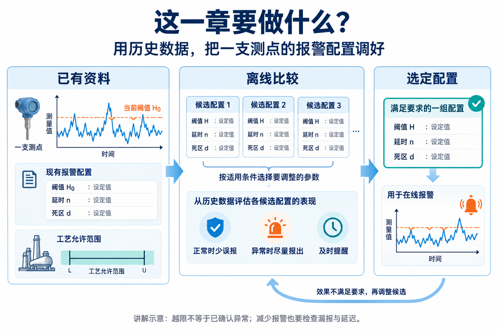

**图片 1｜AI 讲解示意，非原书实验图。** 概述离线比较配置、再用于在线报警的任务；图中参数不表示每次都要同时调整。

已经选定一支测点，也有历史数据和现有报警配置。本章研究：**在工艺允许的范围内，怎样用历史依据调整配置，让正常时少误报、异常时能报出，并留出处理时间。**

| 可调整项 | 实际改变什么 | 例子 |
|---|---|---|
| 阈值 H | 到哪个数值进入报警条件 | 高报警从 100 改为 102 |
| 延时 n | 连续确认多少个采样点才切换报警状态 | 连续 3 点越限才发生，连续 3 点回落才解除 |
| 死区 d | 发生、解除采用不同数值边界 | 本节高报警定义：达到 H+d 才发生，低于 H 才解除 |

离线设计输出新配置；在线把配置应用到后续测量，输出报警状态与发生、解除事件。**报警数变少不足以证明优化成功**，还要看是否漏报、是否报得太晚。

四节使用的依据与选择目标不同，不是每次都要依次执行的四个步骤：

| 小节 | 具备什么资料与条件 | 如何选择、最终调整什么 |
|---|---|---|
| §2.1 IID 条件下的设计 | 能建立正常／异常参考，状态内 IID 假设合理 | 从分布计算 FAR、MAR、AAD，筛选并权衡，选 H、n |
| §2.2 不要求 IID 的设计 | 有正常／异常参考历史，保留时间顺序且统计特征相对稳定 | 从连续段估计确认长度达到的比例，按目标选 H、n |
| §2.3 死区设计 | 有待处理的越限历史；选宽度时有可信正常历史 | 先判断死区是否适用，再按剩余误报警事件比例选 d |
| §2.4 状态转移设计 | 有历史与起点阈值；分区样本足够、转移模型适用 | 统计后续走向和时间，按评分选新 H |

## §2.1：IID 条件下的阈值与延时设计

本节同时考虑“在哪个数值报警”和“连续确认多少点”。比较候选 `(H,n)`，需要先知道正常与异常运行时各会怎样报警，因此先建立参考数据，再评价候选，最后选参数。

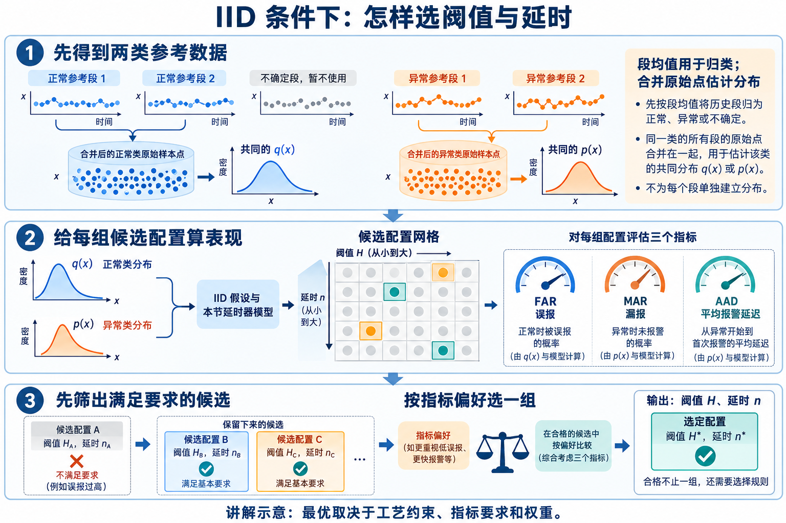

**图片 2｜AI 讲解示意。** 同类段先合并估计分布；每个候选配置得到三个指标，合格候选中再按偏好选一组。

### 建立正常、异常参考：分段、归类，再跨段合并

有可信的两类历史时直接使用；若只有一条混合历史，§2.1.3 提出下图办法（PDF 70–72）。它要求两种状态有不同均值，并有工艺先验帮助解释均值属于哪种状态。

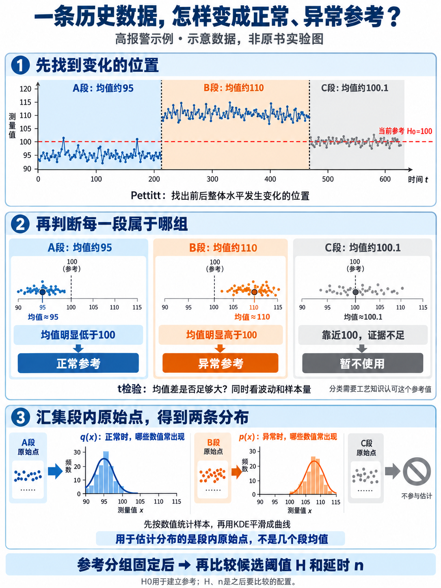

**图片 3｜AI 讲解示意，依据 §2.1.3。** 数值、样本和曲线不是实测或计算结果。

**① Pettitt 检测找变化位置。** 它寻找整体水平变化，例如从 95 附近变为 110 附近；再递归检查两侧，得到多个数据段。此时还没有正常／异常身份。

**② t 检验辅助归类。** 它结合段均值、段内波动与样本量，判断段均值相对参考值的差异是否有足够统计证据。以高报警参考值 100 为例：

| 图中数据段 | 检验结果的含义 | 处理 |
|---|---|---|
| A：均值约 95 | 有足够证据支持均值低于参考值 | 正常参考 |
| B：均值约 110 | 有足够证据支持均值高于参考值 | 异常参考 |
| C：均值约 100.1 | 结合波动和样本量，证据不足 | 暂不参与分布估计 |

**③ 合并同类段的全部原始点，再估计分布。** 不是每段各拟合一套 q、p，也不是用各段均值拟合分布：

| 合并的数据 | 最终估计 |
|---|---|
| 所有正常参考段的原始点合成一个样本集 | 一个共同的正常取值分布 q(x) |
| 所有异常参考段的原始点合成另一个样本集 | 一个共同的异常取值分布 p(x) |

分布说明该类状态下哪些数值常见、哪些少见。书中用 KDE（核密度估计）平滑样本：可理解为在每个原始点处放一个小鼓包，再叠成曲线。“正常状态分布”不等于“正态分布”。

| 阈值记号 | 在流程中的作用 |
|---|---|
| 参考阈值 H0 | 在先验认可的前提下，辅助数据段归类；图中为 100 |
| 候选阈值 H | 参考组固定后，用于比较报警配置 |

这些是基于假设建立的参考状态，不会自动成为独立确认的故障真值；合并还对应同类状态有共同取值分布的假设。

### 给候选配置计算表现

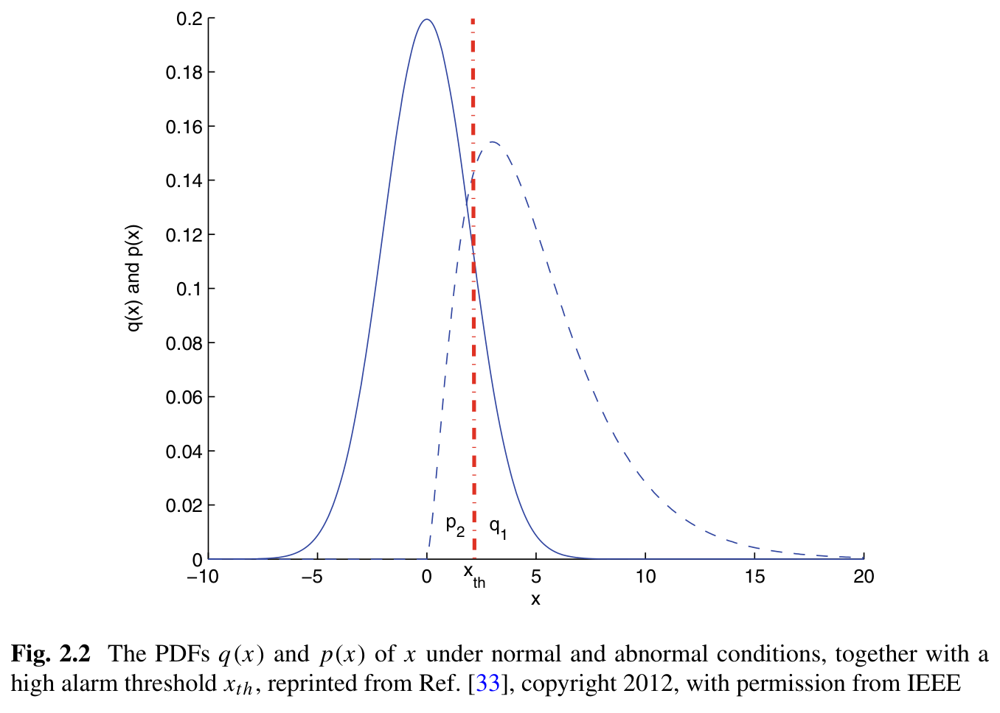

**图片 4｜Fig. 2.2，PDF 63（书页 52）。** 两条曲线重叠：正常时也可能越限，异常时也可能回落。q 在 H 右侧的面积是正常时单点越限概率；p 在 H 左侧的面积是异常时单点未越限概率。

**IID 指独立同分布**：在同一种状态下，知道前面的采样值不改变后面取值的概率，各点分布也相同。书中利用这一假设计算连续确认的效果。延时器本身按下面的规则运行：

| 当前报警状态 | 切换条件 | 尚未满足时 |
|---|---|---|
| 未报警 | 连续 n 点越限才发生报警 | 保持未报警 |
| 已报警 | 连续 n 点回落才解除报警 | 保持报警 |

Markov 链在这里记录延时器走到哪一步，如“已连续越限 1 点、2 点、已报警”。把分布得到的概率与候选 n 代入模型，计算：

| 指标 | 评价什么 | 原书公式 |
|---|---|---|
| FAR | 正常状态下长期处于报警状态的概率 | 式 2.8，PDF 64 |
| MAR | 异常状态下长期处于未报警状态的概率 | 式 2.15，PDF 66 |
| AAD | 从规定的初始未报警状态出发，异常开始到首次报警的平均等待 | 式 2.16，PDF 68 |

n=1 时，上述两个面积就分别是 FAR、MAR；有延时时则需要延时器模型。每换 H，要重算两侧面积；每换 n，要重算延时后的指标。FAR 不只是“连续 n 点越限概率”，还包含报警保持与解除的影响。AAD 也不等于 n；公式包含采样周期及初始状态约定（PDF 67–68）。

### 筛出合格候选，再按选择规则定一组

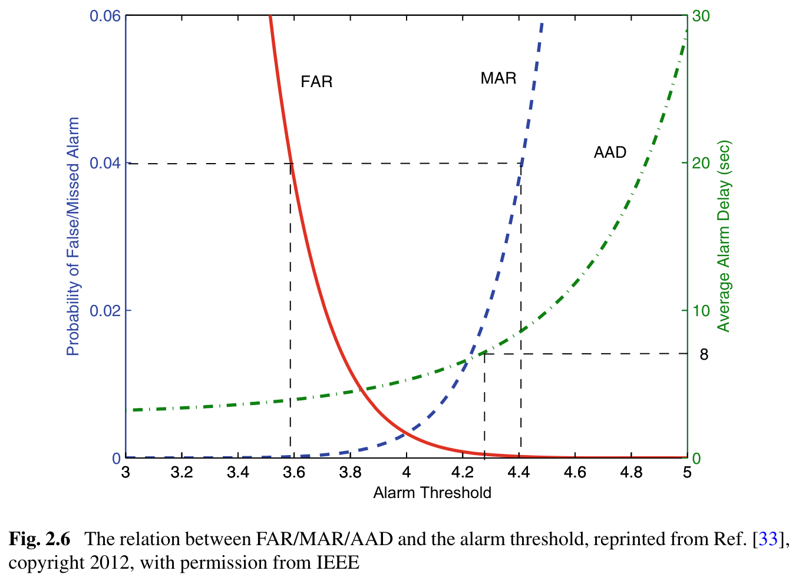

**图片 5｜Fig. 2.6，PDF 73（书页 62）。** 高报警阈值提高，FAR 下降，但 MAR、AAD 可能上升；三项要求可能限定出不同的可用范围。

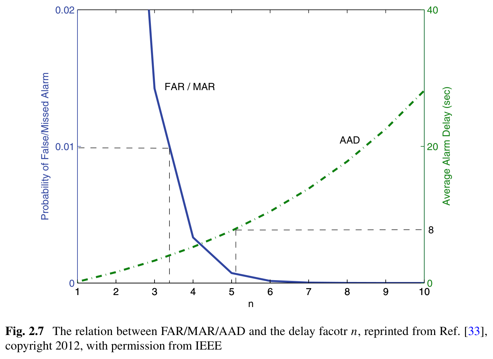

**图片 6｜Fig. 2.7，PDF 74（书页 63）。** 本节对称延时模型下，增大 n 可降低长期误报、漏报状态概率，但首次报警等待增加。MAR 降低与延迟解除跨过短回落有关，不能套到所有检测器。

这两张图用于筛选和权衡，具体操作是：

1. **列候选**：在工艺允许范围按选定步长取 H，n 取允许的正整数；也可固定一项只搜索另一项。
2. **逐组评价并筛选**：例如要求 FAR≤5%、MAR≤5%、AAD≤5 秒，任一超限的候选都不合格。没有候选通过，就没有满足这些要求的解。
3. **在合格项中选择**：可以优先最小 AAD，也可以加权比较三项；不同偏好可能选出不同配置。

原书演示的评分是 `J=ω1·FAR/RFAR+ω2·MAR/RMAR+ω3·AAD/RAAD`（式 2.22，PDF 74）。R 是各项要求；先除以要求，是把概率和秒换成相对尺度。权重表示重视程度，**J 越小越好**。逐组代入、选最小值，就是二维网格搜索，没有一组脱离要求和偏好的通用最优参数。

原书主蒸汽压力例固定**低报警阈值 H=23.6 MPa**，表 2.3（PDF 78）给出如下数据。按上述要求、权重均为 1，J 可复算为：

| n | FAR | MAR | AAD／秒 | 是否合格 | J |
|---|---:|---:|---:|---|---:|
| 2 | 4.68% | 3.05% | 1.4294 | 是 | 1.8319 |
| 3 | 1.16% | 0.60% | 2.8988 | 是 | **0.9318** |
| 4 | 0.25% | 0.10% | 4.5694 | 是 | 0.9839 |

本表三候选按 J 选 n=3；若优先最快提醒，则选 n=2。n=4 虽误报、漏报更低，等待更长却增加了总分。本表不是完整二维搜索结论，也不是本仓库评测结果。

原文数值提醒：表 2.5 另报的联合搜索分数，与表 2.3 和式 2.22 的复算不能直接对上；本笔记保留上面可复算的比较，不把该表联合最优值作为已验证结论。

## §2.2：不依赖 IID 假设的阈值与延时设计

§2.1 用分布和独立性推算延时效果。但实际测量可能连续偏高：`10101010` 与 `11110000` 都有 4 个越限点，n=3 时前者不报警、后者能报警。单点越限比例不能说明排列与连续长度。

因此本节仍设计 `(H,n)`，改从正常／异常参考历史统计实际连续段，保留相邻数据的关系。工况身份需已有依据，不能按候选 H 重新贴正常／异常标签；状态内统计特征还应相对稳定。

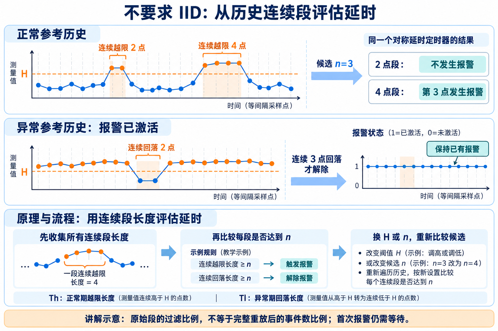

**图片 7｜AI 讲解示意。** 发生和解除使用同一对称延时器；正常期看短越限能否激活，异常且已报警时看短回落会否解除。

### 先数全部段长，再拿候选 n 比较

H 是测量值阈值，Th、Tl 是长度，n 是连续确认点数，不能混成同一种量（PDF 80–83）：

| 在哪类参考历史中统计 | 收集的长度 | n=3 的作用（讲解例子） |
|---|---|---|
| 正常工况 | Th：每段连续越限的点数 | 2 点越限不能激活；4 点越限在第 3 点激活 |
| 异常工况 | Tl：每段连续未越限的点数 | 已报警时，2 点回落不解除；3 点回落在第 3 点解除 |

收集时**不先要求 Th、Tl≥n**。例如全部 Th 为 `[1,2,2,5]`，再试 n=3，只有 5 点段达到确认长度，比例为 1/4；换 n 或 H 后重新比较。

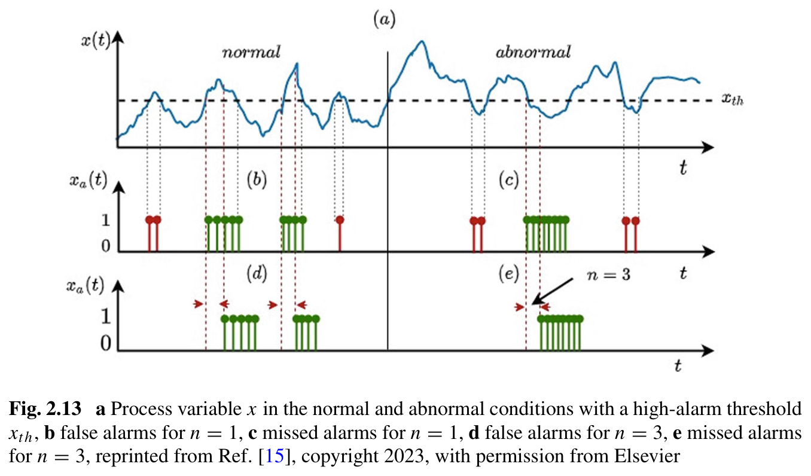

**图片 8｜Fig. 2.13，PDF 83（书页 72）。** (a) 左半是正常工况，(b)→(d) 显示短误报警被滤掉；右半是异常工况，(c)→(e) 标出短漏报警间隔的变化。**右侧竖线在标漏报警，不是实际报警输出为 1。** 红色短段被滤掉，绿色段达到确认长度。

### 从段长统计到参数选择

1. 固定候选 H，分别收集全部 Th、Tl；按式 2.29/2.30，估计达到 n 的段数占原始段数的比例 F、M。
2. 书中用贝叶斯估计给比例附上不确定范围：段数少时，估计可能不可靠。这不产生新的工况标签。
3. 用户给期望比例 Fo、Mo 和权重；遍历 H、n，选“两项偏离期望的加权距离”最小的一组。

选择规则为 `J=ω·|F−Fo|+(1−ω)·|M−Mo|`（式 2.32，PDF 85）。例如等权、目标均为 5% 时，4%／4% 比 1%／15% 更接近目标。**这个目标函数没有 AAD 项**，不保证首次异常检出足够及时。

这里的 F、M 不是逐点错误率。延迟解除可能把相邻越限连成同一次报警，最终事件数仍需完整时序重放；首次报警也需要等待连续确认。按 H 得到的越限段用于评价延时，与 §2.1.3 建参考状态的变点分段用途不同。

原文公式提醒（PDF 83–88）：式 2.29 的“≥n”与式 2.35/2.43 的“从 1 到 n 累加”方向不同，n=1 时也与表 2.6 对不上。上述按 2.29/2.30 解释概念；实现其估计器前必须核对，不能混用。

## §2.3：死区设计——先判断适用性，再选宽度

正常运行时，有些波动只略微越限，却持续较久。用延时过滤可能要等很久，因此本节考虑从幅度上处理：把报警发生与解除的边界拉开，形成死区。

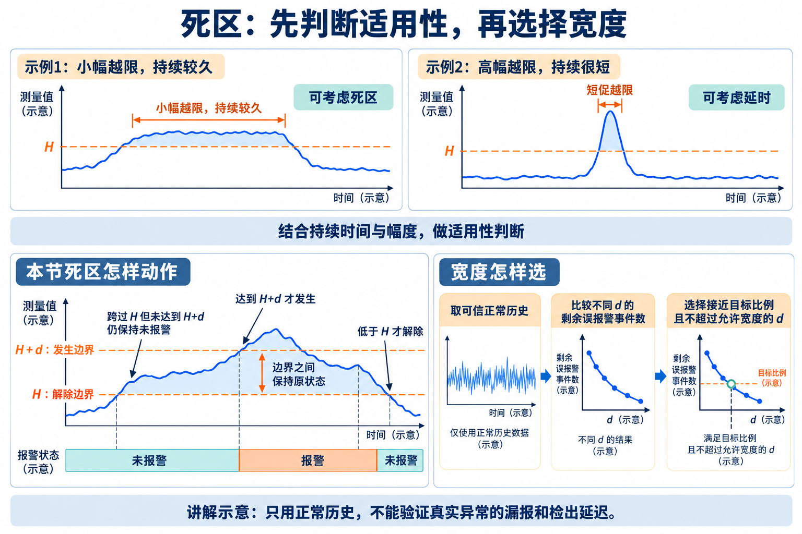

**图片 9｜AI 讲解示意。** 从波动特征判断是否考虑死区，再用正常历史选择宽度。

### 从报警动作到适用性判断

本节高报警采用 **H+d 发生、H 解除**。例如 H=100、d=2：

| 测量变化 | 报警怎样变化 |
|---|---|
| 未报警，涨到 101 | 不激活，尚未达到 102 |
| 达到 102，随后回落到 101 | 先激活，再保持已有报警 |
| 继续跌到 100 以下 | 解除 |

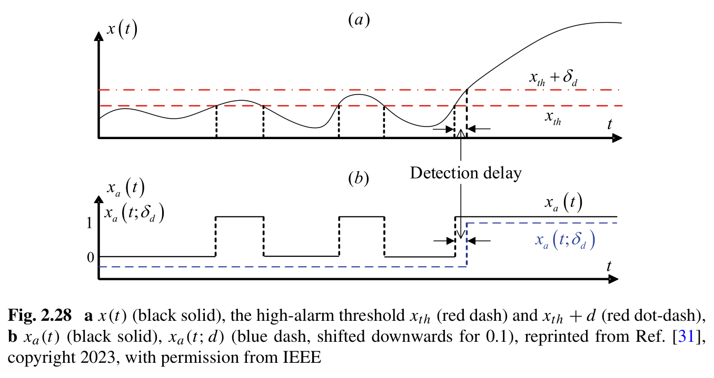

**图片 10｜Fig. 2.28，PDF 99（书页 88）。** 小幅越限被滤掉，后面的大幅变化却也更晚激活。实际系统若采用 H 发生、H−d 解除，须先对齐两条实际边界。

这说明需要先比较波动的幅度与持续时间：小幅、持续久的越限可能适合死区；短促但幅度大的越限，可能用短延时更合适。书中将这个判断做成 **Deadband Index（死区适用性指标）**。

先为每次越限记录最大超限幅度 D 和持续时间 T。秒与℃不能直接比较，所以各除以参考尺度；尺度按变量类型或书中的历史估计法设置（PDF 101–103）。例如仅为讲解，取幅度尺度 2℃、时间尺度 60 秒：

| 一次越限事件 | 横坐标 D/2℃ | 纵坐标 T/60秒 |
|---|---:|---:|
| 最大越限 0.5℃，持续 30 秒 | 0.25 | 0.50 |
| 最大越限 1.5℃，持续 6 秒 | 0.75 | 0.10 |

**一次事件成为一个点，多次事件形成点云。** 用一条经过原点的直线概括点云方向，其倾角就是该指标。横纵坐标相等时是斜率为 1 的对角线，因此得到 **45°**；它是所选尺度下的比较基准，不是通用物理界限。

线越陡，表示相对幅度而言持续时间更长，越有理由考虑死区。书中要求倾角**显著高于 45°**，把估计误差也计入判断；不满足时，该判据不支持使用死区（PDF 104–105）。

### 在正常历史上选宽度，并检查估计是否可靠

确认适用后，取可信正常历史，收集每次越限的最大幅度 D。候选宽度 d 会滤掉 D<d 的事件；例如幅度 `[0.4,0.8,1.6,3]`，d=1 时后两次还能触发，剩余比例 η=2/4。η 是**剩余误报警发生事件数／原事件数**，不等于通常按正常采样点计算的 FAR。

增大 d 也会让真实异常更难触发，甚至完全漏掉。因此书中选择 η **接近用户目标 η0**、并受宽度上限限制的 d；示例 η0=5%，含义是希望原有误报警事件约剩 5%。这没有同时优化漏报和延迟；只用正常历史也无法验证这两项，仍需用可信异常历史检查。

η 又是从有限事件估出的：2/20 与 200/2000 都是 10%，前者更容易波动。为判断这个比例是否可靠，书中采用**贝叶斯估计**：先允许真实比例在 0～1 间取值，再用历史计数更新各取值的可能性，给出估计值与可信范围。范围太宽时应补充样本；它表达比例估计的不确定性，不会替代漏报、延迟验证（PDF 106–108）。

## §2.4：根据历史状态转移选择报警阈值

这一节主要调整 H：已知一段历史和起点阈值，希望判断是否能在较低数值就提醒。阈值太低会报出许多自行回落的波动，太高又可能提醒过晚，因此同时考察后续继续升高的可能性与可争取的时间。

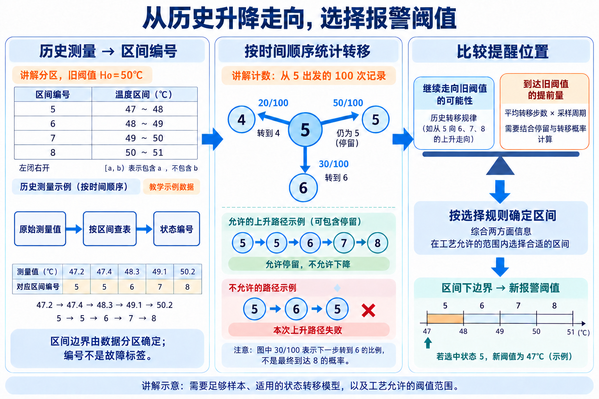

**图片 11｜AI 讲解示意。** 温度分区和计数仅演示流程，不是后面原书概率图的数据。

这条路线不先要求逐点正常／异常标签，但有其他条件：区间内样本足够；当前区间能描述下一步转移，即 Markov 假设；每步停留或移动到相邻区间。书中会处理跨多档跳变（PDF 128）。历史转移规律还需适用于待监测工况；这些条件不合适时，不能直接依图选阈值。

### 从历史测量得到区间与转移概率

**① 分区并编号。** “状态”是测量值所在区间，不是故障类型，也不是时间编号。设置来源如下（PDF 125–127）：

| 内容 | 怎样确定 |
|---|---|
| 起点阈值 H0、允许调整范围 | 来自已有配置和工艺要求，或先在允许范围选一个起点 |
| 每区最小样本量 z | 设计者选择以平衡可靠性和分区精度；书中算法 2 默认 600，并非通用常数 |
| 区间边界、区间数量 | 算法在 H0 两侧按样本数值分布划分，密集处较窄、稀疏处较宽，并调整下方区间数 |
| 首个报警区间 a | 若阈值以下分出 N1 区，则 a=N1+1；并不总是 8 |

讲解例：H0=50℃，附近的状态 5、6、7、8 分别为 `[47,48)`、`[48,49)`、`[49,50)`、`[50,51)`℃。于是 `47.2→47.4→48.3→49.1→50.2` 变成 `5→5→6→7→8`。本例方便手算而等宽；原书分区不要求等宽。

**② 按原时间顺序数相邻转移。** 排序只用于确定数值边界，算升降时必须恢复原来的时间顺序。假设有 100 个当前为 5 且还有下一点的位置：

| 下一状态 | 次数 | 一步概率 |
|---|---:|---:|
| 4，降一档 | 20 | p54=0.20 |
| 5，停留 | 50 | p55=0.50 |
| 6，升一档 | 30 | p56=0.30 |

概率就是相邻 i→j 的次数除以从 i 出发的有效次数；其他状态同样计算（式 2.96，PDF 124）。

**③ 由一步转移计算走向阈值。** 从 5 走到旧阈值 8 的 P58，允许停留、不允许下降：`5→5→6→7→8` 成功；`5→6→5→…→8` 从第一个 5 出发的这次失败，再次到 5 可以另作起点。

上表 p56=0.30 只描述下一步到 6。允许先停留、但不先降到 4，再到 6 的概率为 `r5=0.30/(1−0.50)=0.60`。同样算 r6、r7，在书中模型下相乘得到 P58（式 2.87，PDF 121）；停留概率等也用于计算转移步数。这不是“不限时间，最后曾经到过 8”的概率。

### 读概率图，并据此选择提醒位置

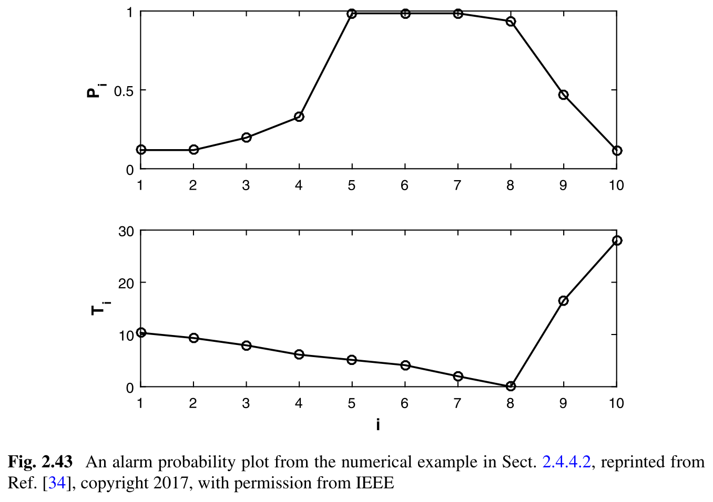

**图片 12｜Fig. 2.43，PDF 120（书页 109）。** 这是另一个数值案例：共 10 区，旧阈值在第 8 区下边界。没有给出实际温度区间，不能把前面讲解分区套进来。

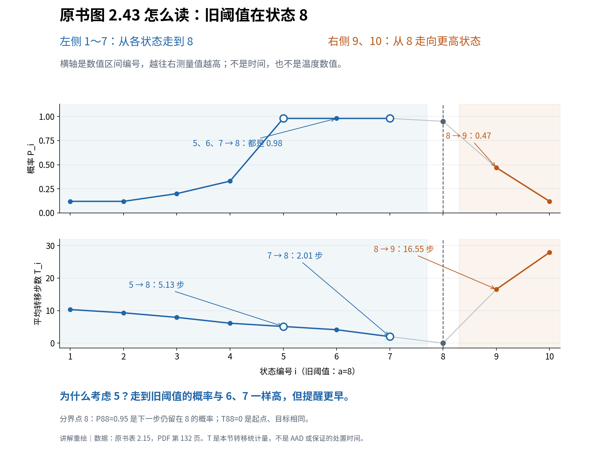

**图片 13｜数据重绘，非 AI 估计。** 使用表 2.15（PDF 132，书页 121）的数字加注，辅助读图片 12。

上下图按同一横坐标配对。a=8 是旧阈值所在区，左侧 k=i<8，右侧目标 m=i>8：

| 横轴位置 | 上图概率 P、下图步数 T 的共同含义 |
|---|---|
| i=1～7 | 从 i 按不下降路径走到 8：Pi8、Ti8 |
| i=9、10 | 从 8 出发，未先退到 8 以下而到达 i：P8i、T8i；此时报警已经发生 |
| i=8 | 特殊约定：P88 是下一步留在 8 的概率，T88=0 因起点目标相同，不表示检测无延迟 |

原图与表 2.15 支持这样的比较：

| 考虑在哪提醒 | 走到旧阈值 8 的概率 | 对应平均步数 | 如何用于选择 |
|---|---:|---:|---|
| 4 | 0.33 | 6.13 | 更早，但多数未沿这条上升路径到 8 |
| 5 | 0.98 | 5.13 | 概率已高，并保留较多提前量 |
| 6 | 0.98 | 4.13 | 概率相同，却更晚提醒 |
| 7 | 0.98 | 2.01 | 同上，提前量更少 |

所以 5 值得优先考虑。右侧 i=9 的 0.47、16.55 则是“8→9”，不是“9→8”或阈值 9 的误报率。T 是本节转移模型的统计量，**不是 AAD，也不保证每次都留出这么久**；换成秒还需乘采样周期。

书中用 `分数=ω·P+(1−ω)·T/Tmax` 选择分数最大的区间；Tmax 取整张图的最大步数，用于统一尺度，ω 表达选择偏好。该数值例等权，状态 5 得分最高（PDF 127、132）。

选中后取该区间的**实际数值下边界**作为新 H。若用前面的讲解分区，5 对应 47℃；不能据此声称原书选了 47℃。比较多个起点阈值时，还需分别分区并重算统计（PDF 127–128）。

这里用后续走向辅助选择，并未按独立真值统计 FAR/MAR。“自行回落”是原书解释不必要报警的线索，不能把 1−0.98=2% 直接称为真实误报率；落地配置仍需核对工艺范围、实际报警效果与可信参考。

术语见 [术语表](../glossary.md)，基本对象见 [第 1 章](ch01-overview.md)，关联变量问题见 [第 3 章](ch03-multivariate-alarm-design.md)。
