# 第 3 章：多变量报警系统优化设计

原文：[参考 PDF](../references/source.pdf)，书页 129–220，PDF 第 139–230 页。
入口：§3.1 PDF 139；§3.2 PDF 164；§3.3 PDF 183；§3.4 PDF 202。

本篇图片在 `references/figures/3/`，按出现顺序编号 `1.png` 至 `13.png`。Gateway 不显示图片时，在项目文件树中直接打开 PNG。

## 这一章要做什么

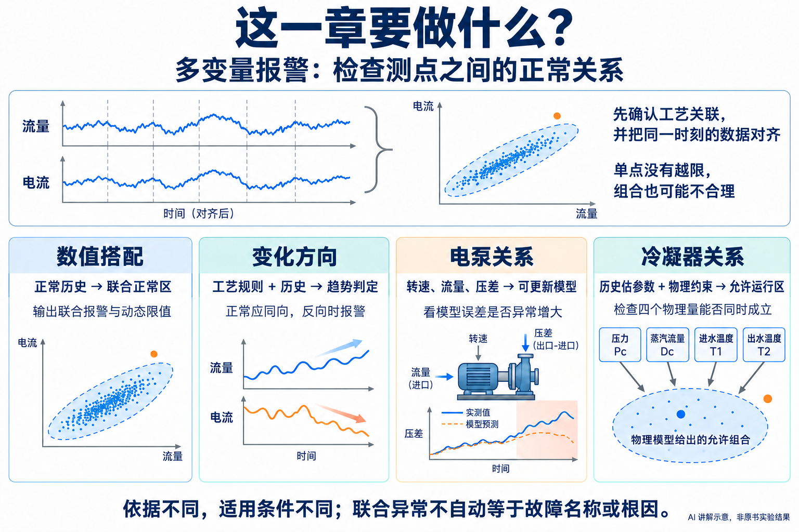

**图片 1｜AI 讲解示意，非原书实验结果。** 四节使用不同依据，不是每次都要执行的四个步骤。

把工艺上相关的测点放在一起，判断**它们的搭配关系是否仍然正常**。例如，流量升高时电流通常也随之变化；单独看流量、电流，都可能没有超出各自的固定范围，但两者已经不匹配。

本章有四条路线，关注的“关系”不同：

| 路线 | 直观地在检查什么 | 建立报警依据时需要什么 |
|---|---|---|
| §3.1 联合正常区 | 这些数值能否正常地同时出现 | 相关测点的同步正常历史 |
| §3.2 变化方向 | 按工艺关系，本来该同升同降，却出现相反方向了吗 | 趋势估计用历史，以及已知的工艺方向规则 |
| §3.3 电泵模型 | 压差、转速、流量之间的关系是否出现异常快变 | 泵的物理量，正常、异常历史及关系模型 |
| §3.4 冷凝器运行区 | 当前温度、蒸汽量和压力是否满足正常换热关系 | 四个物理量的历史、物理模型及运行约束 |

- **离线得到**：联合边界、方向规则所需参数，或设备关系模型与报警参数。
- **在线得到**：当前组合的报警状态；具体路线还会给出动态限值、趋势或模型误差。
- **测点选择**：先有工艺关联，再建模。各列须在时间上对齐，一行代表同一时刻的测量组合。

## §3.1：联合正常区——哪些数值能正常地搭配

### 先看：两个数都没越限，组合为什么仍会报警

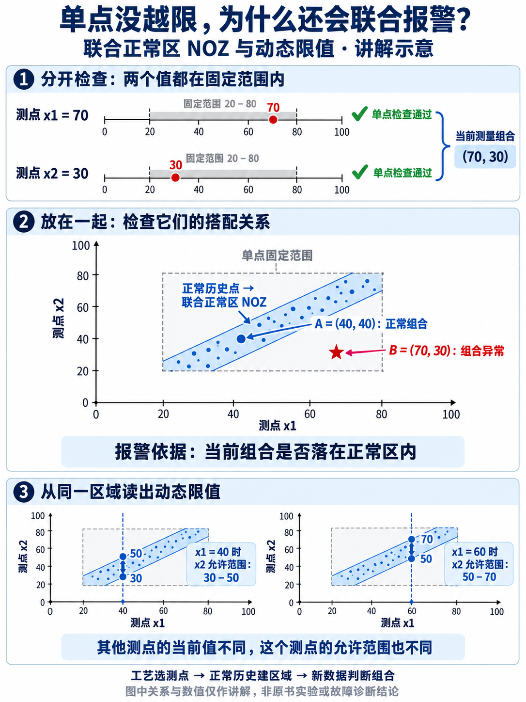

**图片 2：`2.png`，AI 生成的讲解示意图，非原书实验图。** 依据 §3.1 的概念制作；图中数值、点和区域只作说明，不是实测或计算结果。

| 图中检查 | 看到了什么 | 判断 |
|---|---|---|
| 分开看 x1=70、x2=30 | 两个数都在各自的 20–80 固定范围内 | 单点检查通过 |
| 合起来看 (70,30) | 这个点偏离正常历史形成的斜带 | 组合不符合该正常关系 |
| 合起来看 (40,40) | 这个点位于斜带内 | 与该正常关系相容 |

**NOZ（Normal Operating Zone，正常运行区）**就是用来表示这些允许组合的区域。两个变量时可以画成平面上的一块范围；更多变量时，判断原理相同，只是不能在一张平面图中完整显示。

### 这块区域从哪里来

书中先要求有**工艺上确认正常的同步历史**，再从中建立区域（PDF 139–144）：

1. **把同一时刻的测量合成一个点**。例如 `[流量(t), 电流(t)]`；整段历史变成一片点云。
2. **处理明显离群点、统一数值尺度**。标准化把各变量换成“离各自平均水平多少个波动尺度”，防止单位或数值量级主导几何结果。
3. **选取正常点，建立边界**。边界要覆盖可信的正常组合，同时检查内部是否有大片缺乏历史样本支持的空间。

这里的正常身份来自历史运行信息。把当前测量送进模型后，模型检查它是否符合已建立的正常关系。

### “动态上下限”怎样从联合区域得到

看图片 2 的底部：固定 x1 的当前值，沿 x2 方向切过正常区，交出的线段就是 x2 的允许范围。

| 其他变量当前值 | 图中的 x2 允许范围 |
|---|---|
| x1=40 | 30–50 |
| x1=60 | 50–70 |

**区域模型没有变，但随着其他变量的当前值变化，这个测点的上下限会变。** 这就是“动态”的关键含义。边界还可换回原来的工程单位，放在操作员熟悉的时序图上显示。

把图意写成一个可手算的讲解模型：在各自 20–80 的范围内，还要求 `−10≤x2−x1≤10`。这条关系代表图中的斜带，不是用原书数据拟合的结果。

| 当前组合 | 代入同一个区域模型 | 联合判断 |
|---|---|---|
| (40,40) | x2−x1=0，在 −10 到 10 内 | 正常关系成立 |
| (70,30) | x2−x1=−40，超出允许范围 | 联合报警 |
| 固定 x1=60，求 x2 范围 | −10≤x2−60≤10 | 动态限值为 50–70 |

因此，**在线并非再搜索一组阈值**：离线已经建好关系边界，在线把当前组合代进去判断；动态限值是同一边界在当前条件下的表达。

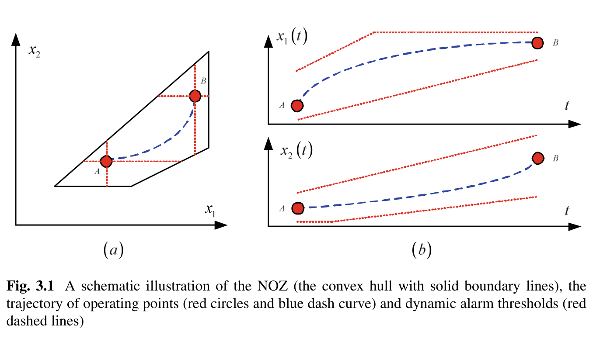

**图片 3：`3.png`**。原书 Fig. 3.1，PDF 第 140 页（书页 130）。

- **左图**：运行点从 A 移到 B，位置始终受联合区域约束。
- **右图**：同一段运动放回时间轴后，各测点具有随当前组合变化的上下限。
- **区域外怎么办**：上述直接切线的例子针对区域内的点。对区域外的点，书中先找对应的正常边界点，再计算限值和偏离情况，详见 PDF 第 145–148、154–156 页。

### 凸包与搜索锥：为什么需要两种边界

**凸包（convex hull）**可以想成用橡皮筋包住所选点云。它内部任意两点的连线都留在内部；Quickhull 是计算这种边界的一种算法。

| 凸区域建模中的处理 | 它的作用 |
|---|---|
| 按距离选代表点，允许舍弃少量外围点 | 避免少量稀疏噪声把区域拉得过大 |
| β 控制不纳入建模的正常点比例 | 表达对正常点被排除的容忍程度 |
| 将区域划成小网格，检查多少格有历史点占据 | 判断包出的空间有多少数据支持；书中称 fitness |
| 逐渐增加历史数据，观察 fitness 是否稳定并达标 | 决定何时接受这个区域模型 |

例如区域内有 13 个网格，其中 9 格出现过正常历史点，fitness 就是 9/13（原书图 3.2，PDF 144）。它检查“包进去的空间有没有数据支持”，不是分类准确率。网格宽度与达标值由设计者根据工艺精度设定；未稳定达标时继续增加历史，而不是直接宣布边界可靠。

β 与后续 FAR 的联系有分布一致等前提；不能仅设置 β=5%，就保证未来实际误报率必定为 5%。本节假定后续正常数据与历史正常数据分布一致，历史应覆盖将要监测的正常工况。

**正常区有凹陷时**，橡皮筋会把凹进去的空间也包住，可能接受本来不应接受的组合。搜索锥方法改成按方向划分许多窄区域，分别确定边界，再拼成整个区域。

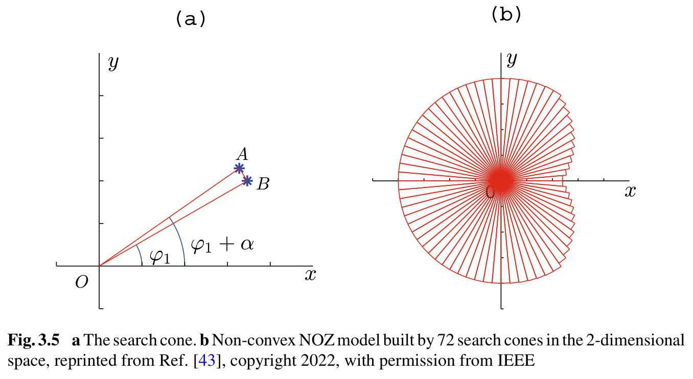

**图片 4：`4.png`**。原书 Fig. 3.5，PDF 第 150 页（书页 140）。

- 左图在二维中像一个窄扇区；多个这样的区域组成右图的形状，高维时用搜索锥表示。
- 每个方向的历史点决定该锥能延伸多远，最后把各锥合并成区域。分得太细会缺样本、边界起伏大，太粗会丢失凹陷；书中试不同角度步长，画出相邻锥边长差异之和，取曲线由陡转缓的“拐肘”作折中（PDF 152–153）。
- 这套表示仍有形状与样本覆盖条件，不能据此认为任意非凸空间都能可靠恢复。

实际建模时，搜索锥把“正常历史”变成“可判断的区域”的过程是（PDF 149–153）：

| 环节 | 怎样做 |
|---|---|
| 划方向 | 在标准化空间，以原点为顶点，按候选角度步长划分搜索锥 |
| 定各方向边界 | 找该锥内离原点最远的历史点，用它确定外侧封口面；锥的侧面由角度范围确定 |
| 处理空锥 | 书中沿用前一个锥的大小；这是缺样本时的补法，不代表该方向已有正常数据证明 |
| 选角度 | 每个候选角度都建一次区域，比较相邻锥边长差异曲线的转折，而非靠任意指定“72 个锥” |
| 判断新点 | 位于任意一个锥的全部边界以内，就属于整个正常区；所有锥均不接纳，才报联合异常 |

这解释了为何需要足够的方向覆盖：如果大量空锥靠邻居补齐，画出的边界虽然完整，历史依据却不足。原书的具体几何系数可回看式 3.19–3.34，无需靠手画区域来实现判断。

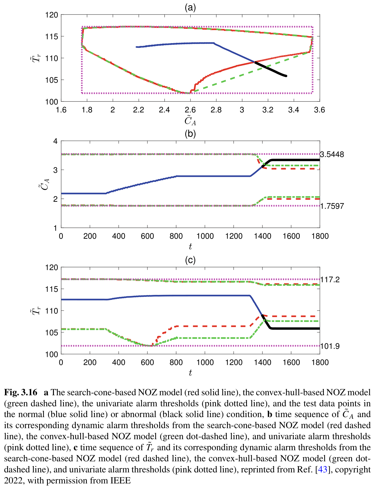

**图片 5：`5.png`**。原书 Fig. 3.16，PDF 第 165 页（书页 155）。

| 读图位置 | 看什么 |
|---|---|
| 上图 (a) | 粉色框是单点范围，绿色虚线是凸包，红线是搜索锥边界；黑色轨迹离开红线范围时，其他边界未必能区分 |
| 下图 (b)、(c) | 同一联合判断变成各变量随时间变化的上下限，便于看到何时、在哪个变量上偏离 |

## §3.2：变化方向——关系有没有走反

有时工艺知识给出的不是一块数值范围，而是“这些变量正常时应该怎样一起变化”。书中的水箱例子很直观：在其模型和正常出口阀条件下，水位 H 升高，出口流量 Fo 也应增大。

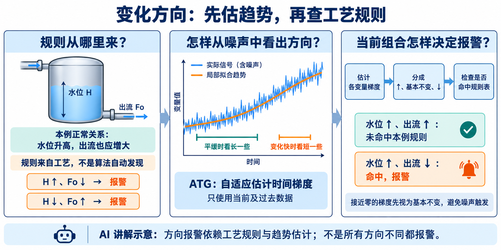

**图片 6｜AI 讲解示意。** 规则由工艺知识给出；ATG 解决如何从带噪声数据中估计方向。

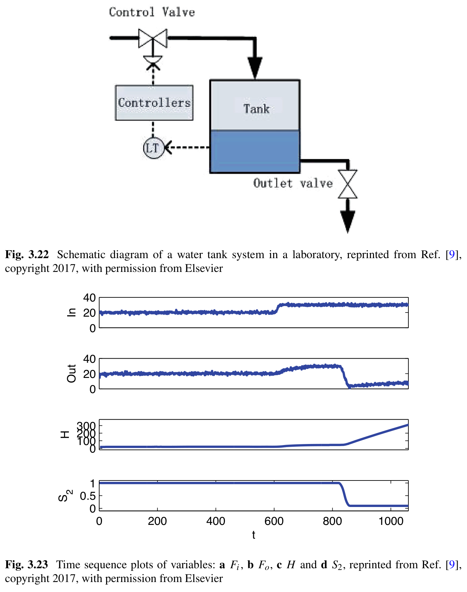

**图片 7：`7.png`**。原书 Fig. 3.22–3.23，PDF 第 177 页（书页 167）。上半部分是水箱，下半部分依次是进流、出流、水位和出口有效面积 S2。

| 原书中的变化 | 出流 Fo | 水位 H | 关系是否符合该模型 |
|---|---|---|---|
| t=600 增加入流 | ↑ | ↑ | 同向，符合 |
| t=821–860 模拟出口堵塞，S2 减小 | ↓ | ↑ | 相反，触发所设异常方向规则 |

### 从带噪声的曲线怎样得到“↑、不变、↓”

**时间梯度**描述一段时间内的上升、下降速度。实际信号会上下抖动，不能只凭相邻两点的一次涨跌判断趋势。

| 处理 | 含义 |
|---|---|
| 用一段近期数据估计梯度 | 提取整体变化方向，减轻逐点噪声的干扰 |
| 梯度显著为正／接近零／显著为负 | 分别记为 +1（↑）、0（基本不变）、−1（↓） |
| 按变化情况调整观察尺度 | 在给定范围内，平稳时可看长一些，变化快时缩短，兼顾稳定与响应速度 |

书中将这种办法称为 **ATG（Adaptive Time Gradient，自适应时间梯度）**：用当前及过去的数据拟合局部斜率，并调整旧数据的权重，得到在线趋势。

1. **离线定标**：选择观察尺度范围，用历史拟合“波动程度怎样对应尺度”，拟合不合格就换训练片段；再从长尺度梯度的波动估计近零带 `[-μ,μ]`（PDF 170–172）。
2. **在线取方向**：梯度大于 μ 记 ↑，小于 −μ 记 ↓，其余记基本不变。例如仅为讲解，某变量 μ=0.2 时，梯度 0.1 不算上涨，0.5 才算；不同变量需按自己的单位定标。
3. **查规则表**：R 的每一行是一种需要报警的方向组合；本例列 `(H↑,Fo↓)`、`(H↓,Fo↑)`，当前组合命中才报警（PDF 173）。因此方向提取与工艺判断是两件相连的事，不是所有方向不同都报警。

例如某时刻估计出 H 的梯度为 +0.5、Fo 为 −0.4，假设各自近零带均为 ±0.2，则得到 `(+1,−1)`，命中上述规则；若 Fo 梯度为 +0.1，则是 `(+1,0)`，不命中这两条。这里为手算使用相同近零带，实际两者单位不同，应各自估计。

本节的优化对象主要是**如何稳定而及时地提取方向**。方向规则仍来自工艺知识；ATG 不会仅凭历史，自动知道“水位升、出流降”意味着出口堵塞。与 §3.1 相比，它适合有明确变化关系、却不容易给出完整数值正常区的场景。

## §3.3：电泵——允许正常慢变，识别异常快变

这节研究凝结水电泵。相同流量可能对应不同转速和压差，正常工况本身也会变化，因此书中建立了一个可随时间更新的关系模型。

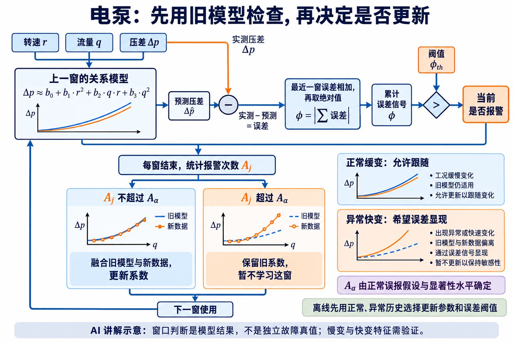

**图片 8｜AI 讲解示意。** 当前窗口先用上一窗模型评价，避免先把异常学进去，再拿更新后的模型判断自身。

| 测量量 | 含义 | 在关系模型中做什么 |
|---|---|---|
| r | 泵转速 | 与流量一起解释正常压差 |
| q | 流体流量 | 同上 |
| Δp | 泵进出口压差 | 与模型预测值比较，得到误差 |

书中的模型形式是 `Δp≈b0+b1·r²+b2·q·r+b3·q²`。这些系数描述当前工况下三者的关系；正常工况转换时，系数也可以改变。

### 判断依据：模型能不能合理地跟上变化

| 情况 | 模型怎么处理 | 预期结果 |
|---|---|---|
| 正常关系缓慢变化 | 逐窗更新系数，允许跟随 | 预测误差仍较小 |
| 关系出现异常快变 | 受限制的模型跟不上 | 一段时间内的累计误差增大 |
| 一个窗口内报警过多 | 暂停更新，保留前一窗参数 | 避免继续把可疑变化适应进模型 |

**Bayesian filter（贝叶斯滤波）在这里的作用**：把上一窗对模型的认识，与当前窗数据提供的信息，按可信程度融合，得到新系数。

- 保留旧模型过多，正常变化也可能跟不上；适应过快，又可能把异常变化一起跟随掉。
- 书中用正常、异常两组历史选择更新参数，并在保证正常拟合质量时拉开两组误差信号。
- 对本节泵而言，“正常慢变、异常快变”是需要验证的特征，不能把任何设备的快速工况切换都直接当成故障。

### 报警信号到底是什么，阈值从哪里来

1. 用上一窗模型预测当前压差，得到“实际压差−预测压差”的误差。
2. 把最近一窗误差**相加后取绝对值**，得到 ϕ；不是把每项绝对误差相加。
3. ϕ 超过其阈值时报警；每窗再根据报警数量，决定是否更新模型。

每窗结束时数报警点数 Aj，与正常误报假设下的计数界限 Aα 比较：不超过才融合新数据更新系数，超过则保留旧系数（PDF 193–194）。Aα 从窗口长度、正常 FAR 与显著性水平确定；书中假设正常误报警近似独立，不能忽略这个条件。

### 参数和误差阈值怎样选

更新参数 kp 越大，越信任旧模型：异常更容易显出误差，但正常变化也更难跟上。书中先要求正常历史的拟合分数 F 达标，再选“异常最大 ϕ − 正常最大 ϕ”较大的 kp。表 3.4 的例子（PDF 197，F≥95%）：

| kp | 正常拟合 F | 两类最大误差的间隔 | 选择含义 |
|---|---:|---:|---|
| 0.79 | 95.32% | 0.2281 | 合格 |
| 0.84 | 95.04% | 0.2742 | 本表合格项中间隔最大，选它 |
| 0.89 | 94.56% | 0.3328 | 间隔虽大，正常拟合不达标 |

选定后，误差阈值取两组最大值中点：`ϕth=(0.1503+0.4245)/2=0.2874`（式 3.88）。这依赖有代表性的正常、异常设计历史，不是正常样本分位数阈值，也不保证独立时段维持同样性能。

### 真正使用时，离线与在线怎样接上

| 阶段 | 按什么顺序做 |
|---|---|
| 离线准备 | 对齐 r、q、Δp，准备能代表正常慢变及异常快变的两组设计历史 |
| 确定窗口和更新参数 | 模型有 M 个解释项，书中取 N=M+2，兼顾尽量快更新与参数可估计；用惩罚参数 kr 抑制解释项相关造成的系数不稳定 |
| 搜索 kp 和误差阈值 | 按上表先筛正常拟合，再比较两组误差分离；确定 ϕth，同时按正常 FAR 设定报警计数界限 Aα |
| 在线循环 | 旧模型预测→累计误差并报警→窗末统计 Aj→决定更新或冻结→进入下一窗 |

例如某窗有一些误差一正一负，相加可能接近零；另一窗误差持续偏正，ϕ 就会增大。因此这个报警量着重识别**关系模型持续偏向一侧**，不能把它理解成“任何强烈波动都一定有大 ϕ”。

窗口和惩罚参数见 PDF 194–197。原文式 3.89 写选满足条件的最大惩罚参数，但表 3.3 选 0.009，而更大的列值也满足；严格复现须核对。在线窗口身份仍是模型判断，不是独立故障真值。

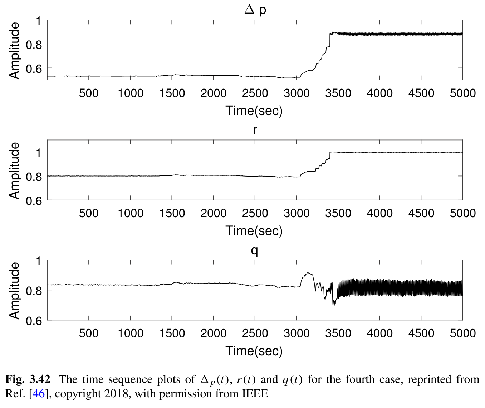

**图片 9：`9.png`**。原书 Fig. 3.42，PDF 第 201 页（书页 191）；测量已归一化。

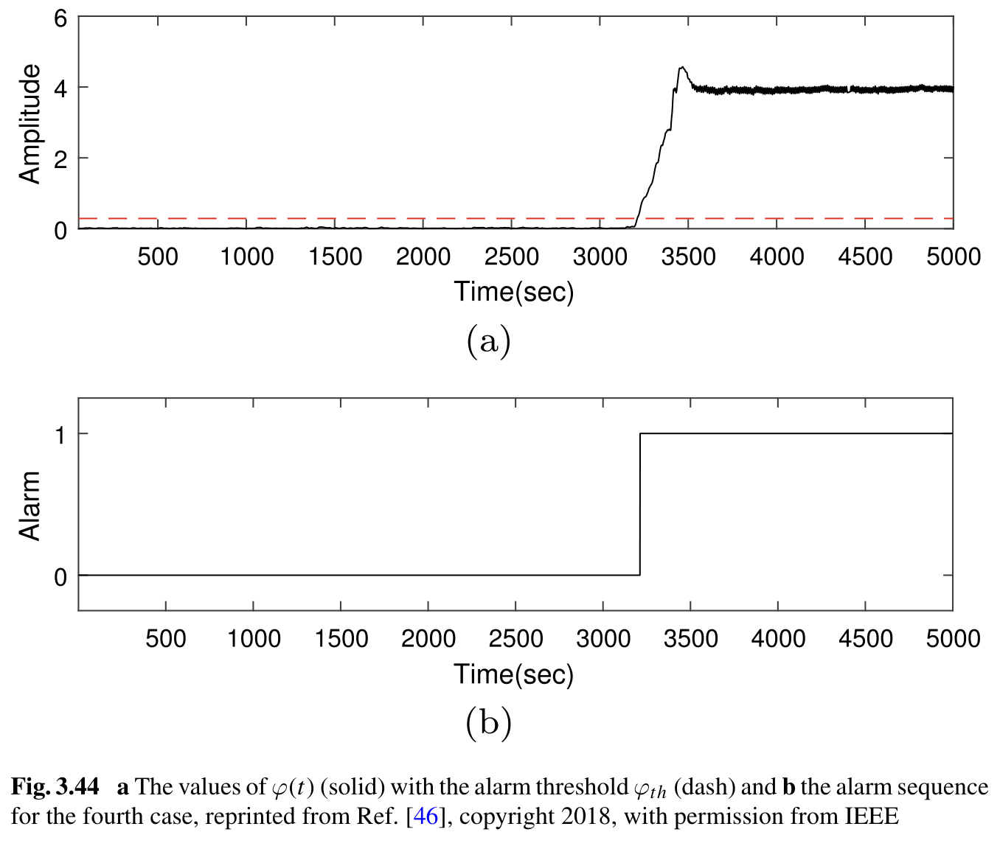

**图片 10：`10.png`**。原书 Fig. 3.44，PDF 第 203 页（书页 193）。

- 图片 9 中，约 3200 秒后测量关系发生变化，流量波动也明显改变。
- 图片 10 上图的 ϕ 增大并越过阈值，下图转为报警状态。
- 最终比较的是关系模型的误差；并非只在流量曲线上另画一条固定高限。

## §3.4：冷凝器——先用物理模型生成允许组合

冷凝器用冷却水带走蒸汽的热量，使蒸汽凝结。水温、蒸汽量和压力之间存在物理关系，不能只看某一个量是否超限。

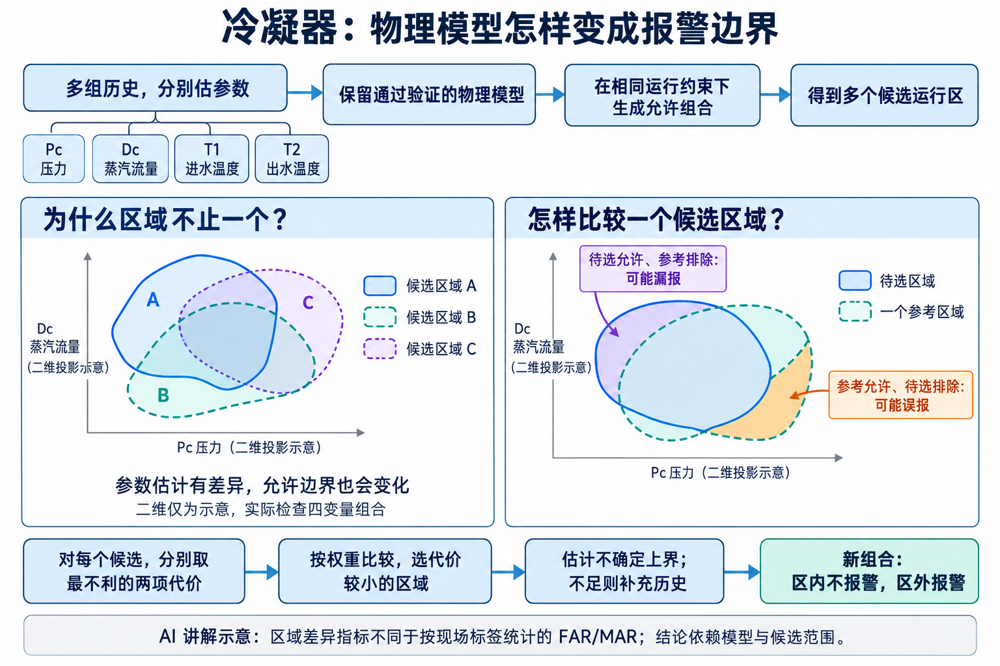

**图片 11｜AI 讲解示意。** 二维区域只帮助解释差异，实际检测针对四变量组合。

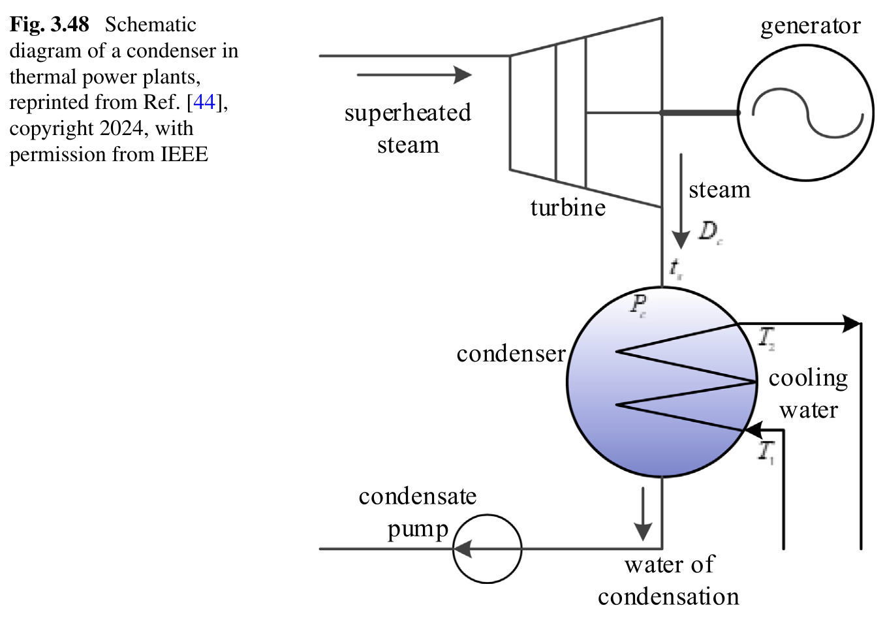

**图片 12：`12.png`**。原书 Fig. 3.48，PDF 第 207 页（书页 197）。

| 量 | 含义 |
|---|---|
| Pc | 冷凝器压力 |
| T1、T2 | 冷却水进入、离开冷凝器的温度 |
| Dc | 进入冷凝器的蒸汽流量 |

### 运行区怎样得到：历史估参数，物理关系生成点

| 步骤 | 具体在做什么 |
|---|---|
| ① 用四列历史估计模型参数，再验证 | 检查根据水温、蒸汽量等预测的压力，是否与实际压力相符；模型拟合不足时不能继续使用 |
| ② 给定正常运行约束 | 例如该案例规定压力 6–11 kPa，出入口冷却水温差 6–12℃，凝结温度与出水温度之差 1.5–6℃ |
| ③ 按物理关系生成允许组合 | 在这些约束范围内，计算哪些 `(Pc,Dc,T1,T2)` 能同时成立，得到四维点集 |
| ④ 用搜索锥表示运行区 | 新测量组合在区域内则不报警，在区域外则报警 |

这里生成的点是**物理模型给出的允许组合**，不全是历史中已经实际出现过的点。上述范围属于原书设备案例，不是所有冷凝器的统一限值。

“生成允许组合”也有具体顺序，不是把四个量各自随机取值再凑起来（PDF 209）：

1. 在允许范围选一个压力 Pc，通过蒸汽饱和关系求凝结温度 ts。
2. 选定允许的 `ts−T2`，求出水温 T2；再选定允许的 `T2−T1`，求入水温 T1。
3. 将这三个量代入已估好的换热模型，算出对应蒸汽量 Dc，得到一个四维允许点。
4. 遍历这些范围，形成点集，再用搜索锥表示边界。遍历步长按测量分辨率选，原书案例使用 0.1 kPa、0.1℃。

由此，当前 Dc 即使没有触及单点上限，也可能**超过当前压力与水温条件所能容纳的蒸汽量**。这正是本节联合报警的工艺含义。

### 为什么还要讨论“模型不确定性”

不同历史片段带有噪声，估出的物理参数可能稍有不同，产生的允许区域也会不同。若实际正常区是其中一个或接近其中一个，选定区域与它的差异就可能导致误报警、漏报警。

| 选定区域与所比较参考区域的关系 | 可能的结果 |
|---|---|
| 参考区域允许，选定区域却排除 | 将可能正常的组合报为异常 |
| 选定区域允许，参考区域却排除 | 接受可能异常的组合 |

选择过程是（PDF 211–216）：

1. **形成候选**：多组历史分别估参数；保留压力预测通过验证的模型，在同样物理约束下各生成一个运行区。
2. **逐个比较**：暂选区域 A，把其他候选逐一当参考，计算上表两种区域差异；各自取最不利值，作为 A 的两项代价。对 B、C 等重复。
3. **按偏好选区**：计算 `J=w·误报代价+(1−w)·漏报代价`，选 J 最小者（式 3.117–3.118）。例如讲解值 A 为 0.08/0.02、B 为 0.03/0.05，等权时 B 的 0.04 小于 A 的 0.05；更重视漏报时可能改选 A。
4. **检查估计可靠性**：候选有限，代价本身也有不确定性。贝叶斯估计用已有样本更新可能取值，给出上界；相对估计值仍过宽就补充历史、重估区域，而不是只报告一个看似精确的小数。

前提是实际运行区能由候选模型代表，或与其中之一很接近。这里的 FAR/MAR 按原书区域体积差异定义，不能当成独立测试集的逐点错误率；贝叶斯上界也不会凭空补足故障标签。

### 一个只看压力容易漏掉的组合

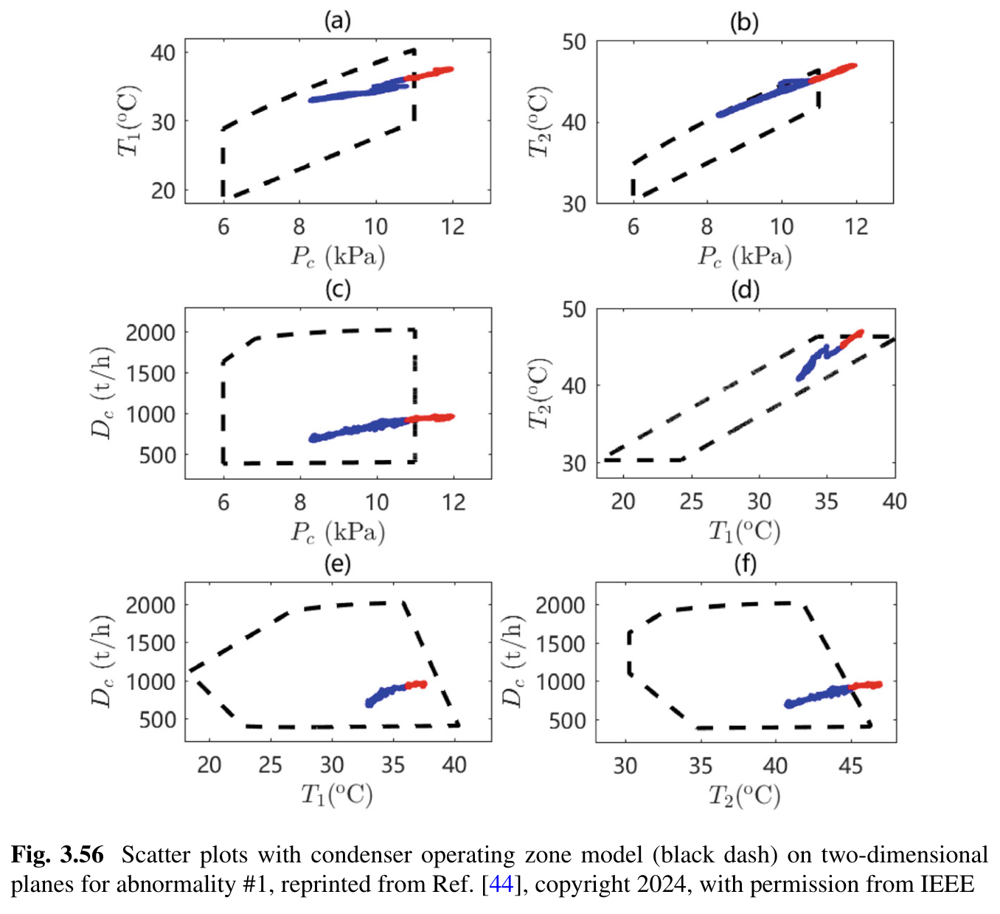

**图片 13：`13.png`**。原书 Fig. 3.56，PDF 第 223 页（书页 213）。黑色虚线是运行区投影，蓝点、红点分别为该案例正常和异常数据。

| 原书检测到联合异常时的测量组合 | 数值 |
|---|---|
| Pc | 10.79 kPa，尚未达到单点高限 11 kPa |
| T1、T2 | 36.08℃、44.95℃ |
| Dc | 906.81 t/h |

- 图 (f) 显示，在当前出水温度下，这个蒸汽量组合已经越出允许区；读图要把温度与蒸汽量放在一起。
- 二维投影方便展示，但可能丢失信息；实际判断仍针对四变量组合。
- 该行流量沿用原书工业图的 t/h，模型推导中也使用 kg/s，代入公式前须统一单位。

原文核对提示：PDF 第 211 页的区内／区外文字次序与式 3.106 相反；本笔记依据式 3.106、3.131 及前文定义，采用**区内 0，区外 1**。

## 阅读与使用时抓住的区别

| 已有资料 | 可以优先理解的路线 |
|---|---|
| 能代表将来正常工况的同步正常历史 | §3.1 联合正常区与动态限值 |
| 工艺上知道哪些变化方向不合理 | §3.2 方向规则与趋势提取 |
| 有电泵物理量，并能验证正常慢变、异常快变特征 | §3.3 可更新关系模型及误差报警 |
| 有冷凝器物理模型、参数估计历史与运行约束 | §3.4 物理运行区及不确定性分析 |

“联合异常”表示违反所建立的正常关系，具体故障名称和根因还需要其他证据。单点规则见 [第 2 章](ch02-univariate-alarm-design.md)，报警后的根因分析见 [第 4 章](ch04-root-cause-analysis.md)，术语可查 [术语表](../glossary.md)。
