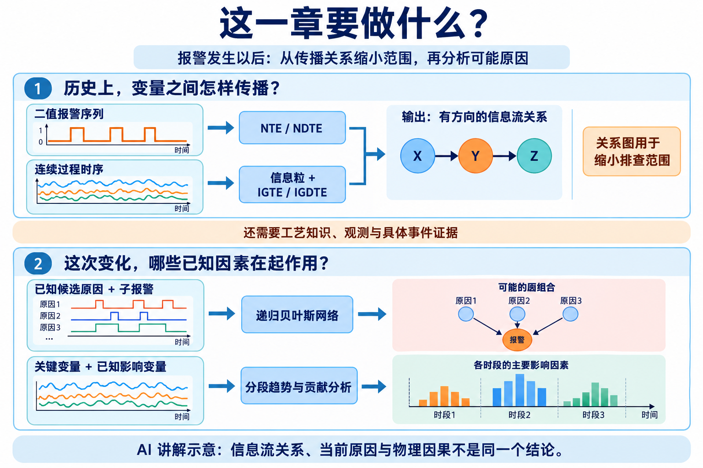
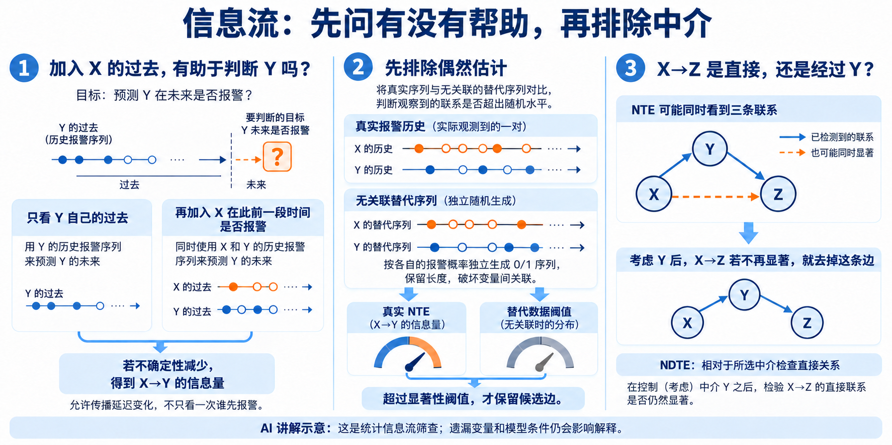
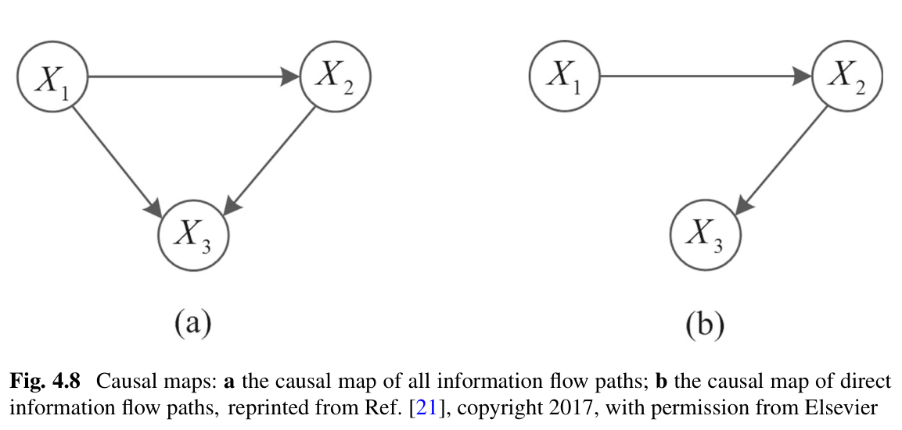
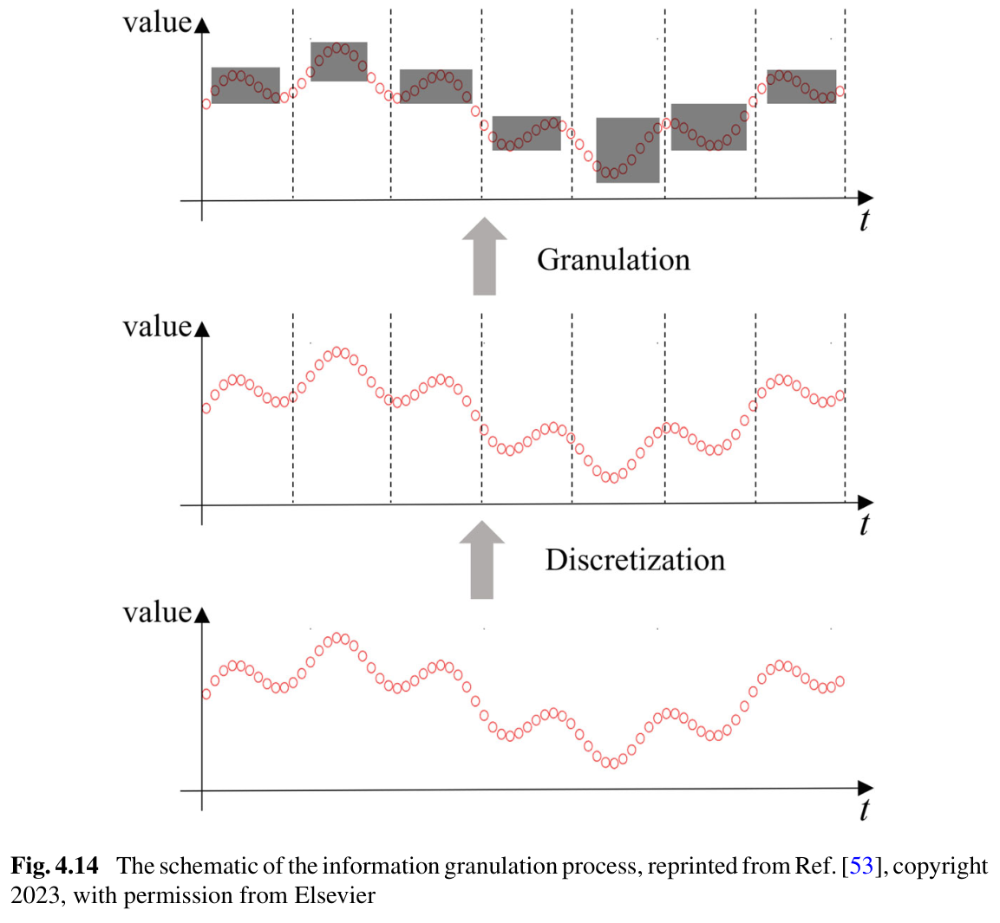
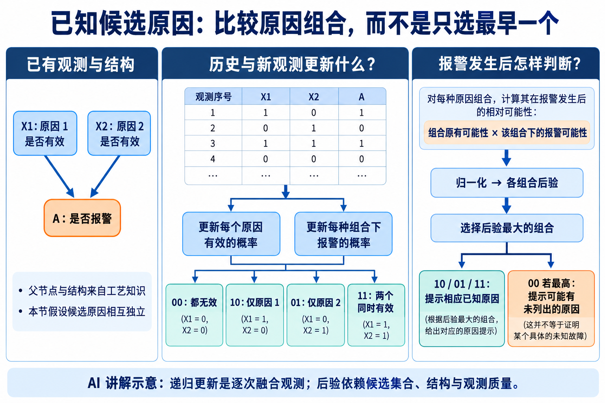
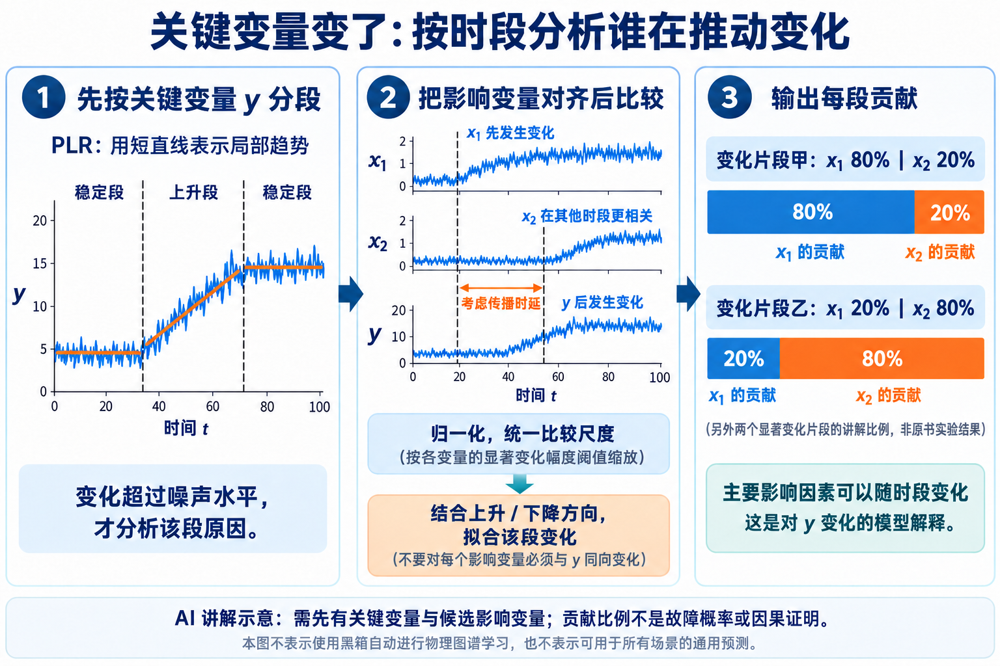
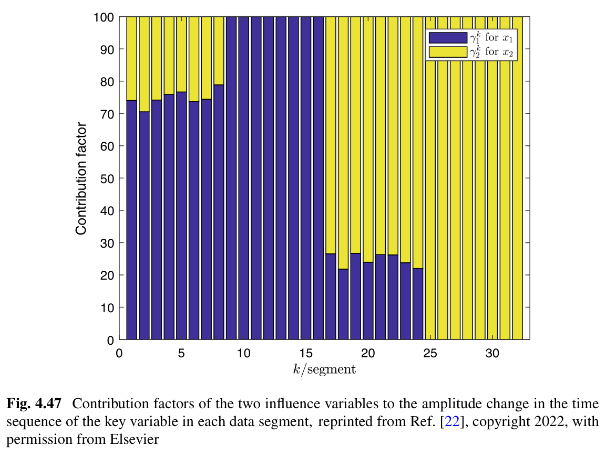

# 第 4 章：报警发生后，怎样分析传播关系与可能原因

原文：[参考 PDF](../references/source.pdf)，书页 221–301，PDF 第 231–311 页。
入口：§4.1 PDF 231；§4.2 PDF 249；§4.3 PDF 272；§4.4 PDF 287。
图片在 `references/figures/4/`，依次为 `1.png` 至 `7.png`；远程预览不显示时可在项目文件树打开。

## 这一章要做什么

**图片 1｜AI 讲解示意，非原书实验结果。** 上半利用历史找关系，下半需要具体观测和已有候选因素，不能凭一张关系图自动完成诊断。

一次设备异常可能带出一串报警。逐条看，很难知道从哪里查起。本章的目标是**缩小排查范围，并解释哪些因素可能在推动当前异常**。

| 已有资料 | 本章怎样利用 | 输出是什么 |
|---|---|---|
| 多支 Tag 的二值报警历史 | §4.1 比较有方向的信息量，再检查中介影响 | 报警间的候选传播关系图 |
| 同步连续过程历史 | §4.2 先压缩为保留变化的表示，再分析信息流 | 过程变量间的候选关系图 |
| 已知原因状态与一个子报警 | §4.3 学习概率，报警时比较各原因组合 | 最可能的已知原因组合，或集合外原因提示 |
| 关键过程量及其已知影响量 | §4.4 分段、对齐、解释变化 | 每段趋势与主要影响变量的贡献 |

前两节是关系发现，后两节是特定条件下的原因分析。输入中的报警身份、候选原因和工艺关系，需要先有来源；这些方法不会自动补齐所有未观测故障。

## §4.1：从报警历史找传播关系，再排查中介

### 为什么不能只看谁先报警

例如 X 的异常传到 Y，有时相隔几秒，有时更久；只对比某一次的先后顺序容易失误。本节用很多次历史共同估计关系，要求报警发生近似独立，并考虑随机发生延迟（PDF 231–232）。

输入是对齐后的 0/1 报警序列，而不是直接把压力、流量值代入。持续报警、反复抖动和相互独立的异常发生也应分清：一段日志很长，不一定包含足够多独立事件。

**图片 2｜AI 讲解示意。** 左侧说明 TE 的一般思想；本节再针对报警发生的特点修改历史信息和延迟处理。

### NTE 到底在计算什么

**TE（转移熵）**问的是：已知 Y 自己的过去，再知道 X 的过去，会不会更容易判断 Y 的下一状态？如果有帮助，就得到 X→Y 的信息量；反方向需另算。

书中的 **NTE（归一化转移熵）**将这种帮助除以目标原有的不确定性，并把来源的一段报警历史合并考虑，以容纳随机延迟。它不是“X 报警后 Y 也报警的次数比例”。

| 要设置什么 | 从哪里决定、有什么作用 |
|---|---|
| 最大候选延迟 D | 设计者给定可接受传播时间范围，逐个延迟计算 NTE，保留最大值及对应延迟 |
| 来源历史范围 l1 | 根据报警间隔统计选择，覆盖多数随机发生延迟；太宽会把原本无关的发生也混进来 |
| 目标历史范围 k1 | 书中在发生独立假设下取 0；一般 TE 的设置不能无条件照搬 |

具体规则见 PDF 235。原书的 20 上限与其采样、时间约定相连，换采样周期时不能直接把 20 点当 20 秒。

“合并历史”在原书式 4.4 中有明确含义：统计目标下一状态为 1 的样本时，来源窗口只要出现过一个 1，就将合并值记为 1，例如 `[0,1,0]→1`；目标下一状态为 0 时，使用指定延迟处的单个来源状态。它是本节专门的**离线统计规则**，不是把所有窗口统一求平均，也不是普通预测模型的输入构造。

### 概率从哪里来：先配对、计数，再算信息量

用一个简化讲解例把统计过程接起来：固定一个延迟，来源历史长度取 1，暂不加入目标自身历史。对齐后有 1000 对“来源过去状态、目标下一状态”：

| 来源过去状态 | 目标下一状态为 1 | 为 0 | 该行合计 |
|---|---:|---:|---:|
| 1 | 80 | 20 | 100 |
| 0 | 20 | 880 | 900 |

- 不看来源，只知道目标报警概率为 `100/1000=0.1`。
- 看来源后，来源为 1 时目标报警概率为 `80/100=0.8`；来源为 0 时为 `20/900≈0.022`。
- 这些频数给出联合概率、条件概率；熵衡量按这些概率猜目标状态还有多少不确定性。

本例原有熵约 0.469 bit，纳入来源后约 0.211 bit，归一化减少量约为 `(0.469−0.211)/0.469=0.55`。**数值的来路是历史配对计数，不是人为指定一条传播概率。** 这是说明统计含义的简化例子；实际需按上面的历史规则计算，并对每个候选延迟重复。

### 怎样从一个 NTE 值决定画不画边

有限数据即使无关联，也可能算出正值。书中建立一个“没有传播关系时，大致会算出多大”的对照（PDF 237–240）：

1. 对每支报警序列保留长度和报警概率，按各自概率**独立生成**随机 0/1 替代序列。
2. 对很多替代样本重复计算相同指标，按书中 Monte Carlo 流程得到显著性阈值。
3. 真实数据的 NTE 超过该阈值，才保留有向候选边。它表示超出这个对照模型的随机水平，不是已经证明物理因果。

原书工业例中，Tag1→Tag2 的 NTE=0.2577，高于对应阈值 0.0155，因此保留该边（PDF 246–247）。**0.2577 不能直接读成“25.77% 的事故由 Tag1 引起”。**

书中流程要求每支至少约 50 次报警发生，这是其数值分析给出的使用条件，不是所有系统的通用充分样本量（PDF 240）。原文以 α=0.01、99 次替代数据说明检验，同时写严格 `P<α`；此时最小 Monte Carlo p 值恰为 0.01，边界记号需核对，不能直接宣称严格小于已经成立。

### NDTE 为什么还要算一次

若实际为 `X→Y→Z`，X 的历史也可能帮助预测 Z，NTE 图便可能多出 `X→Z`。**NDTE（归一化直接转移熵）**进一步考虑中介 Y，看 X 是否仍有额外信息。

**图片 3｜原书 Fig. 4.8，PDF 245（书页 235）。** (a) 包含 X1→X3，(b) 在考虑 X2 后去掉这条间接联系。

书中先从 NTE 图找可能的中介，再按 NDTE 与相应阈值比较、修剪边（PDF 242–243）。可以这样理解两次计算的区别：

| 比较 | 在问什么 |
|---|---|
| NTE：加入 X 的历史 | X 能帮助解释 Z 吗？沿 X→Y→Z 传来的信息也可能算进去 |
| NDTE：已考虑 Y，再加入 X | Y 已经解释过以后，X 还提供多少额外信息？ |
| 额外信息未超过对照阈值 | 暂无证据保留 X→Z 这条直接边，而非删掉 X→Y→Z 整条传播路径 |

因此，先找边、再检查中介，最终得到较简洁的排查图。“直接”只相对于已纳入的变量和检验条件；遗漏共同原因、反馈结构或事件不足，都可能限制解释。图仍不能独立确定当前事故的根因。

## §4.2：连续过程数据怎样变成可估计的信息流

压力、流量等连续曲线往往带噪声、分布变化；直接估计很多历史维度的联合概率很费样本。本节先把短时变化压缩，再做信息流计算。

### 信息粒不是一个新传感器，而是一小段数据的表示

**图片 4｜原书 Fig. 4.14，PDF 252（书页 242）。** 从下往上读：原始曲线→按时间分窗→用粒描述各窗的数值范围与中心；不是每个原始点被判为某种故障。

| 处理 | 具体含义 |
|---|---|
| 按不重叠短窗取数据 | 一窗代表一小段历史，保持各变量在时间上的对应 |
| 每窗表示成 `[下支撑点, 中心, 上支撑点]` | 中心取中位数；两侧支撑点按覆盖与紧凑程度确定，不必等于最小、最大值 |
| 对这些三维表示做 OPTICS 密度聚类 | 把相似窗口归组；OPTICS 用邻域密度组织样本，避免提前指定一个固定簇数 |
| 按簇中心大小重排状态编号 | 使编号仍反映数值变化方向，不能保留任意聚类编号就声称保留趋势 |

例如按式 4.23–4.24，一窗 `[9,10,10,11]` 得到 `[9,10,11]`：中心是中位数 10，下支撑为下半窗均值的两倍减中心，上支撑同理。它同时表达水平与散布；若只取均值，就无法区分“始终在 10 附近”与“在 10 两边大幅摆动”。

| 讲解中的原始窗 | 信息粒（三个数） | 聚类后可能得到的类别 |
|---|---|---|
| [9,10,10,11] | [9,10,11] | 低水平、窄波动的一类 |
| [19,20,20,21] | [19,20,21] | 高水平、窄波动的另一类 |
| [0,10,10,20] | [0,10,20] | 中心水平相同，但更宽，未必与第一窗同类 |

表中是表示差异的手算例，实际类数和归属由整批信息粒的密度聚类得到；还需设置邻域与最小密度参数。类别编号表示相似窗口，不是“故障 1、故障 2”。

### 从窗口和频数走到 IGTE / IGDTE

1. 用上述表示代替原始点，比较“只知目标历史”和“再知来源历史”时的预测信息，得到 **IGTE（信息粒转移熵）**。
2. 窗口与历史阶数需要一起选。原书延迟为 16 点的例子中，一阶用 16 点窗，可能压掉太多变化；二阶用 8 点窗并纳入更多历史，取得较稳定的估计。三阶计算更慢，也未明显改善稳定性（PDF 258–260）。这是例子支持的选择，不是任意数据一律取 8。
3. 在聚类后的特征序列上生成破坏变量关联的替代数据，估计显著性阈值；真实 IGTE 超过阈值才保留边（PDF 260）。
4. 已有 X→Y→Z 等候选路径时，用 **IGDTE**考虑中介，区分额外直接信息和间接影响（PDF 261）。

这里的“估计概率”仍然是数出现次数。假设粒化、聚类后，把状态简写为低/高，以下只列出**Y 当前都为低**的 100 个窗口配对：

| X 当前类别 | Y 下一窗低 | Y 下一窗高 | 给定这一行，Y 下一窗高的概率 |
|---|---:|---:|---:|
| 低 | 45 | 5 | 5/50=0.1 |
| 高 | 10 | 40 | 40/50=0.8 |

若只看 Y 当前为低，下一窗高的比例为 45/100；加上 X 的类别后，预测明显分开。IGTE 就把所有历史类别组合下这种额外信息汇总起来。二阶时，每行的条件还要包含再前一窗的类别，**不是给每个原始测量值单独拟合一个分布**。

本节降低表示维度、尝试保留动态关系，并不意味着任何非平稳数据都能恢复真实因果图。要检查分窗是否抹去所关心的变化、簇是否有足够样本、时延是否合理；粒化之后仍然需要概率估计与显著性判断。

## §4.3：已有一组候选原因，报警时怎样比较组合

例如某个子报警 A 可能由原因 X1、X2 引起，且两者可能同时有效。只看谁最早出现，可能漏掉并存原因；观测短暂跳变又可能造成误判。

本节需要：工艺上已确定的父节点→子报警结构、各候选原因的二值状态观测、子报警状态，并假定候选原因相互独立（PDF 272–273）。它不是从任意测点自动学出任意贝叶斯网络。

**图片 5｜AI 讲解示意。** 两原因有 00、10、01、11 四种组合，后验比较允许同时选择多个原因。

### “递归更新”和“后验”各自做什么

| 环节 | 直观操作 |
|---|---|
| 更新原因概率 | 每来一条观测，融合旧估计与当前原因是否有效；学习速率决定新观测占多大权重 |
| 更新条件报警概率 | 对当前出现的原因组合，更新“此组合下 A 报警的概率”；未出现的组合保留已有估计 |
| A 报警时比较组合 | 每组计算“这组原本多常见 × 这组出现时多容易报警”，再除以各组总和得到后验 |

**后验**就是看到报警后，各种原因组合的相对可能性；**递归**是逐条更新，不必每次把全部历史重新拟合。精确更新见 PDF 274–276。

先看一张已建立的概率表怎样用于推断。设 `P(X1=1)=0.2`、`P(X2=1)=0.1` 且独立；以下数值为便于手算的假设，不是原书实测：

| 组合 X1X2 | 组合原有概率 | P(A=1｜组合) | 两者相乘 | 看到报警后的后验 |
|---|---:|---:|---:|---:|
| 00 | 0.72 | 0.05 | 0.036 | 14.12% |
| 10 | 0.18 | 0.80 | 0.144 | **56.47%** |
| 01 | 0.08 | 0.70 | 0.056 | 21.96% |
| 11 | 0.02 | 0.95 | 0.019 | 7.45% |

分母是 `0.036+0.144+0.056+0.019=0.255`，因此本例选择 10。虽然 11 下报警最容易发生，但它本来很少见，后验未必最大。这说明为什么不能仅比较条件报警概率。

这张表需要先用已有历史或先验认识初始化，之后根据真实观测逐条修正。沿用上述旧估计，假设学习速率 λ=0.1，新来的一条观测为 `(X1,X2,A)=(1,0,1)`：

| 更新哪一项 | 这条观测怎样改变它 |
|---|---|
| X1 有效概率 | 0.9×0.2+0.1×1=0.28 |
| X2 有效概率 | 0.9×0.1+0.1×0=0.09 |
| 10 组合下的报警概率 | 0.9×0.8+0.1×1=0.82 |
| 00、01、11 下的报警概率 | 本次没有观察到这些组合，保留旧值 |

本次若 A=0，第三行则降为 `0.9×0.8=0.72`。所以条件概率来自“某组合出现时，子报警是否出现”的观测积累；长期没出现过的组合，仍然缺少数据支持。λ 大则更快跟随近期观测，也更容易受短暂跳变影响。

两个环节各有用途：观测到原因和子报警的状态时，**更新概率表**；要根据子报警给出原因提示时，**使用当前表比较组合**。若原因状态已准确、完整地知道，直接观测本身也是重要依据，不应把后验表当成比观测更高一级的真值。

### 怎样读输出

- 最大者为 10、01 或 11：给出对应的一项或多项已知原因提示。
- 若 00 最大：书中将其作为集合外原因的提示；观测不准、候选不全或模型失配也需排查，不能自动编造具体故障名。
- 概率依赖历史、学习速率、独立性与结构假设；模型输出仍需现场核实。原书对全零组合的编号在前后段落有变化，实现时应按实际状态组合识别，不凭下标猜含义。

## §4.4：关键过程量发生变化，分时段解释谁在推动

同一物理影响路径不代表任何时刻都在起作用。这里先选关键变量 y，如冷凝器真空，再由工艺知识选可能影响它的温度、流量等 xi；目标是解释 **y 这一段显著变化**，不是为全部测点无差别排名。

**图片 6｜AI 讲解示意。** 右侧比例只说明不同变化片段可能由不同变量主导，不是左侧稳定段的计算结果。

### 分段、对齐、筛选，再计算贡献

| 步骤 | 为什么需要、实际怎样做 |
|---|---|
| ① 用 PLR 分段 y | PLR 是分段直线表示；试候选段数，比较各段直线置信带与数据包络的重合程度，取按段长加权评分最高者（PDF 289–291） |
| ② 判定显著变化 | 段内总变化要超过按噪声估计的幅度阈值，才记上升或下降；y 基本不变的段不分析根因（PDF 291–292） |
| ③ 估时延并对齐 | 先平移 xi 与 y 做滞后相关，筛出有统计支持的延迟，再在相对应时段比较，避免把传播等待错当成无影响（PDF 292–293） |
| ④ 统一尺度、保留有效趋势 | 各变量按自身显著变化幅度阈值缩放；未显著变化的 xi 排除，其余按同向、反向关系调整符号 |
| ⑤ 在该段拟合并算贡献 | 用非负约束回归解释 y 的变化，把各变量解释的幅度分量换成比例（PDF 294–297） |

“贡献”不是原始变化幅度排名。例如某因素温度变了 1℃，另一个流量变了 100 t/h，不能直接比 1 和 100；既要对齐、缩放，也要结合与 y 的关系模型。

### 从一段测量算到贡献比例

以下是已完成分段、时延对齐的一段讲解数据；各行仍是段内不同时刻，不是只拿两个端点拟合：

| 时刻 | x1 | x2 | y |
|---|---:|---:|---:|
| 1 | 0 | 0 | 0 |
| 2 | 1 | −0.1 | 2.2 |
| 3 | 1.5 | −0.6 | 4.2 |
| 4 | 3 | −0.8 | 7.6 |
| 5 | 4 | −1 | 10 |

假设此前按噪声估计的显著变化阈值分别是 x1 为 2、x2 为 0.5、y 为 5；本段三者都有显著变化。y、x1 上升而 x2 下降，所以将标准化后的 x2 反号，再与 x1 一起做非负回归。

1. 各列减去本段均值，再除以各自上述阈值；回归得到 x1 的系数 0.8，反号 x2 的系数 0.2。
2. 换回 y 的单位：x1 对应变化 `0.8×(5/2)×4=8`；x2 对应变化 `0.2×(5/0.5)×1=2`。最后的 4、1 是各自的变化幅度。
3. 合计解释变化 10，份额为 `8/(8+2)=80%`、`2/(8+2)=20%`。

这里 x2 下降仍可解释 y 上升，因为拟合考虑了反向关系。实际数据带噪声时，原书用分段直线估计的变化幅度，减少端点抖动影响（式 4.85–4.88）。若拟合差或候选量缺失，比例即使加起来为 100%，也不等于解释已充分。

**图片 7｜原书 Fig. 4.47，PDF 301（书页 291）。** 横轴是片段编号，纵轴是贡献百分比；紫色、黄色堆叠柱分别对应 x1、x2，同段合计 100%。比较同一片段两者的份额，而不是把整段历史压成一个永久排名。

该方法假设片段内关系可由所选影响变量近似线性解释。遗漏变量、候选间高度相似或拟合不足，会影响分配；贡献因子不是故障概率，也不是干预实验确认的因果效应。

## 怎样带着问题回原文

| 想进一步核对 | PDF 位置 |
|---|---|
| 报警 NTE 的历史处理、延迟与 NDTE 修剪 | 233–243 |
| 信息粒参数、聚类频数和阶数选择 | 251–261 |
| 贝叶斯网络的更新与组合后验 | 273–279 |
| PLR 分段、显著阈值、时延和贡献计算 | 289–298 |

报警如何产生见 [第 2 章](ch02-univariate-alarm-design.md)、[第 3 章](ch03-multivariate-alarm-design.md)；大量报警的组织与检索见 [第 5 章](ch05-alarm-floods.md)。
