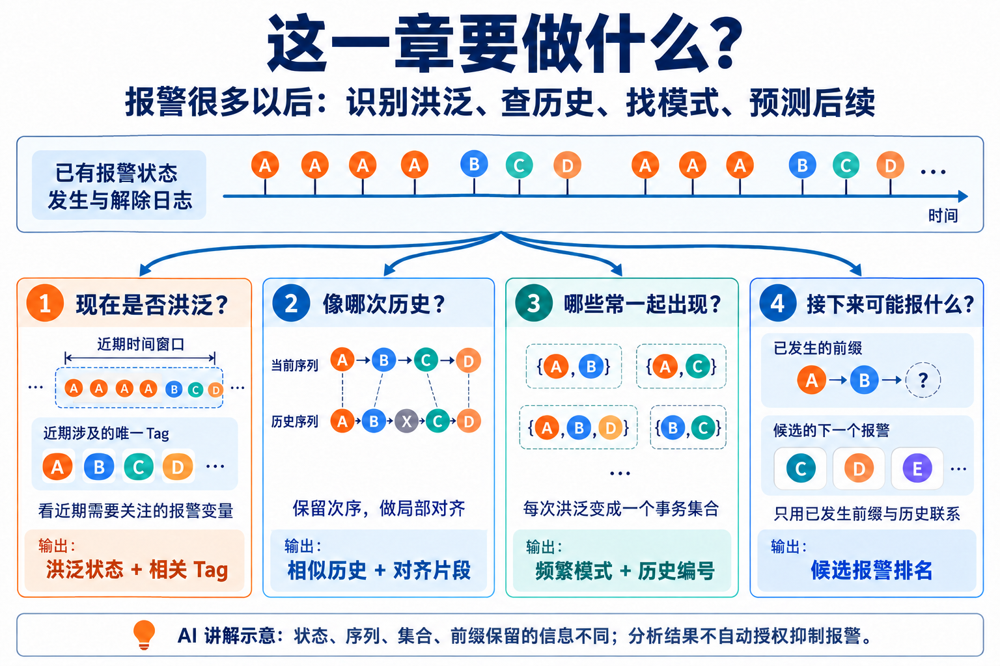
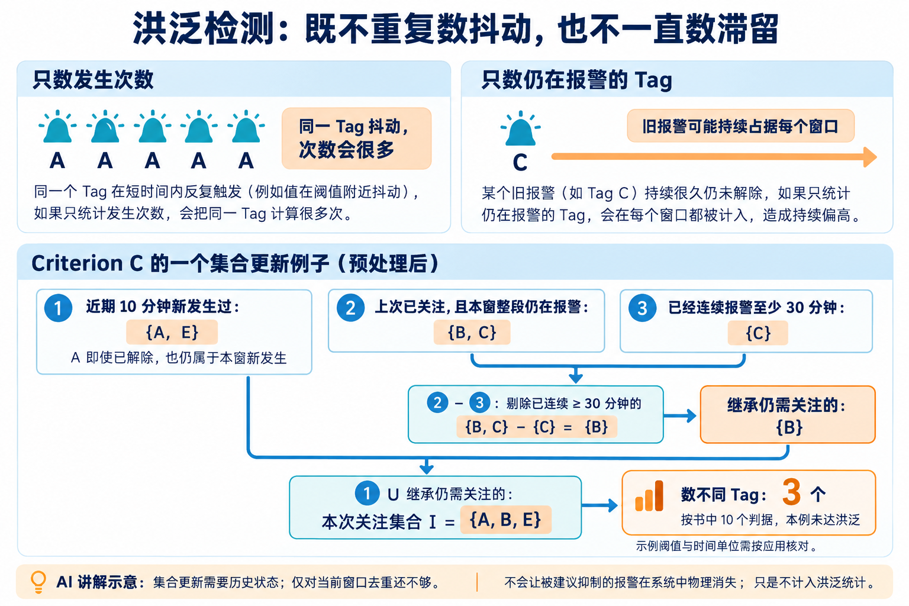
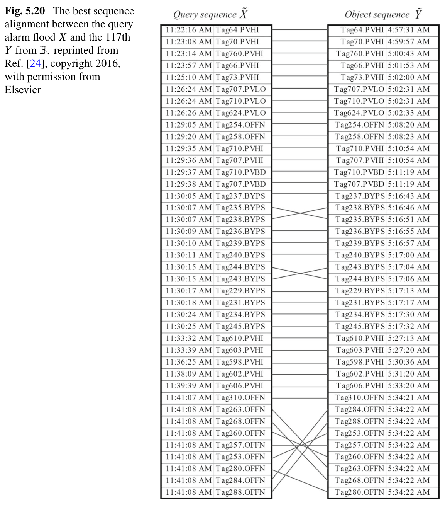
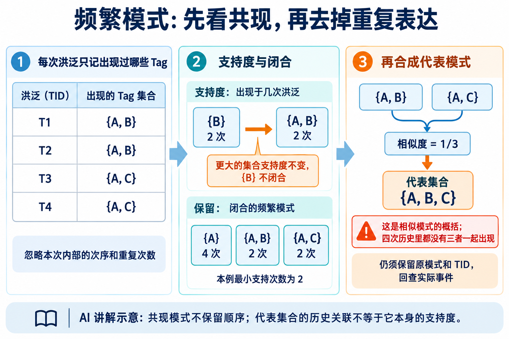
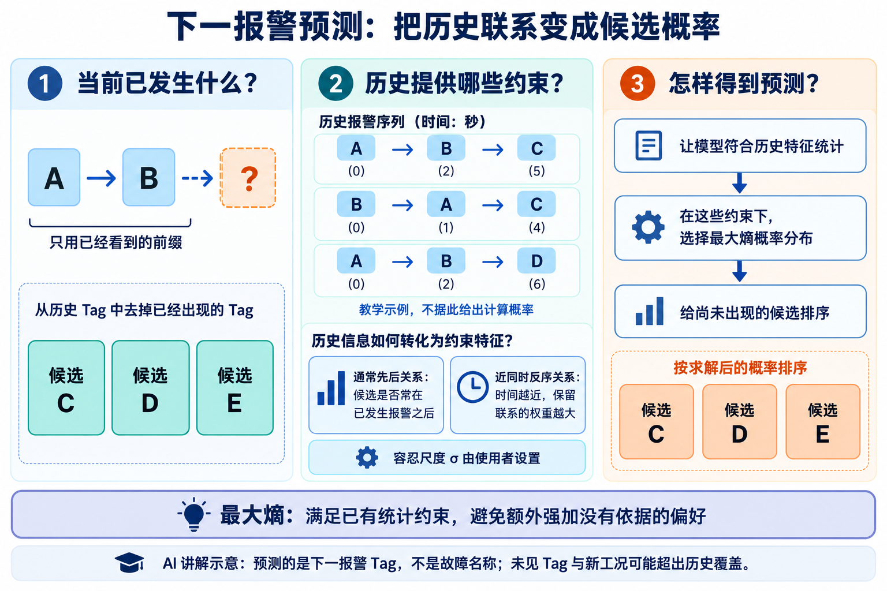
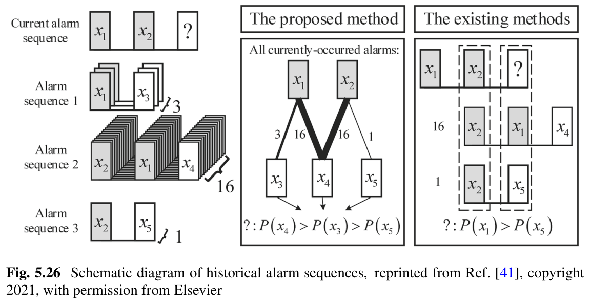

# 第 5 章：报警洪泛——怎样识别、检索、归纳与预测

原文：[参考 PDF](../references/source.pdf)，书页 303–379，PDF 第 312–388 页。
入口：§5.1 PDF 312；§5.2 PDF 331；§5.3 PDF 353；§5.4 PDF 365。
图片在 `references/figures/5/`，依次为 `1.png` 至 `6.png`；远程预览不显示时可在项目文件树打开。

## 这一章要做什么

**图片 1｜AI 讲解示意，非原书实验结果。** 四节保留的信息和输出不同，不是四种可以直接混排的异常检测器。

前两章研究怎样产生更合适的报警；本章面对的是**报警已经很多，操作员怎样看得过来、查得下去**。

| 问题 | 用什么资料 | 做完得到什么 |
|---|---|---|
| 是否进入洪泛？ | 多支 Tag 的报警、解除状态历史 | 洪泛指示、相关 Tag 和时间段 |
| 与哪次历史相似？ | 已划分的、有时间与优先级的洪泛事件序列 | 局部对齐、相似分数及历史编号 |
| 哪些报警经常共同出现？ | 每次洪泛的 Tag 集合及编号 | 频繁模式、代表模式和历史关联 |
| 接下来可能报什么？ | 历史序列与当前已经看到的前缀 | 未出现候选的下一报警预测 |

原始压力、流量不直接替代这些输入。首先要从发生、解除记录还原状态，或从状态抽取发生事件；再按任务选择保留时间顺序、重复次数还是只保留成员。

## §5.1：怎样判断洪泛，先明确到底在数什么

“10 分钟内有 10 个报警”看似简单，但同一 Tag 抖动十次，与十支不同 Tag 同时需要处置，负担并不一样。

| 判据 | 实际计数 | 容易混入什么 |
|---|---|---|
| A | 窗口内 0→1 的发生次数 | 同一 Tag 的反复抖动 |
| B | 窗口内至少一次处于报警状态的 Tag 数 | 很久以前发生、一直未解除的旧报警 |
| C | 本窗新发生，加上仍需继承关注的 Tag 集合 | 仍需维护历史状态和处理剩余抖动 |

### Criterion C 怎样更新集合

**图片 2｜AI 讲解示意。** 剔除是“不重复计入洪泛负担”，不意味着解除或抑制实际设备报警。

书中按 1 秒采样说明，近窗为 10 分钟（PDF 319–323）：

1. **本窗新发生过的 Tag 都纳入**，每个只算一次；即使窗口结束前已经解除，也确实给操作员带来过新任务。
2. **从上次关注集合继承**那些本窗整段仍在报警的 Tag，避免处理尚未完成就立刻丢掉。
3. **继承时去掉已连续报警至少 30 分钟的 Tag**，避免同一旧报警永远占据每个窗口。
4. 合并两部分，数不同 Tag。书中 C 判据达到 10 个时标为洪泛，同时输出集合供人工核验。

例如本窗新发生 `{A,E}`，上次已关注且本窗一直报警 `{B,C}`，其中 C 已持续 30 分钟，则本次为 `{A,E}∪({B,C}−{C})={A,B,E}`，共 3 个，不到 10。只给本窗事件表，却不保留过去状态，无法完成后两步。

### 从判据到连续运行还要做什么

- **先处理抖动**：书中用延时器过滤持续或间隔小于 20 秒的短促报警；去重本身并不能消除所有抖动。
- **选择更新步长 T**：可每秒更新，也可按较大步长扫描历史；10 分钟是回看窗，T 是多久更新一次，二者不同。
- **需要时再稳定洪泛指示**：连续 m 次满足才进入，连续 m 次不满足才退出。确认时间与 m、T 都有关，也会增加在线检测延迟（PDF 324）。

10 分钟、10 个、30 分钟、20 秒是该节的判据和设定；换采样周期须转换为物理时间。不要把“已从计数排除”写成“已证明无须处置”。

## §5.2：当前洪泛像哪次历史——保留顺序做局部对齐

若历史为 `A→B→C→D`，当前为 `A→B→X→C→D`，插入 X 不应让整段历史完全失配。只比较无序集合，又会失去 A、B、C、D 的传播次序。

本节每个事件保留 **Tag、时间戳、优先级**。目标是找相似的局部片段，不要求两次洪泛从头到尾完全相同。

### 匹配、间隙和高分片段分别是什么

| 动作 | 在这个例子中意味着什么 |
|---|---|
| 匹配 | A 对 A、B 对 B 等，给正分；优先级高的匹配更重要 |
| 不匹配 | 用一个不同 Tag 与当前 Tag 对齐，扣分 |
| 插入间隙 | 为额外 X 留一个空位，承担间隙惩罚，再继续对齐 C、D |
| 局部选择 | 找得分好的那一段，不必把首尾无关报警硬对齐 |

| 对齐后的位置 | 1 | 2 | 3 | 4 | 5 |
|---|---|---|---|---|---|
| 历史 | A | B | — | C | D |
| 当前 | A | B | X | C | D |

**Smith–Waterman（SW）**用动态规划比较这些选择：逐格记录到当前位置的局部最好分数，再回溯得到片段。序列很长、历史很多时，完整比较成本高；本节借鉴 **BLAST** 的“先找种子、再延展”来加速。

评分有具体取法。原书表 5.5 的三档优先级，匹配分别给 6、4.5、3 分，错配 −2.5，间隙 −1。如果上例 A、B、C、D 都为低优先级，图示对齐的基本分为 `4×3−1=11`。它比完全匹配的 12 少，但没有因一个额外事件丢掉整段联系；这些是**对齐分数，不是 11% 或 12% 的预测概率**。

实际搜索会比较所有允许的选择。例如错配要扣 2.5，改用两个间隙只扣 2，所以方法可跳过两边不对应的事件，继续寻找后续匹配。局部得分降到没有价值时，可另起一段；不必让无关前缀拖低后面的高分匹配。

### 怎样从大量历史中找到值得细比的片段

1. **集合预匹配**：先按共同 Tag 与优先级粗筛；几乎无共同内容的历史不进入昂贵对齐。这只是筛选，最终仍比较序列。
2. **找种子**：在筛后序列中找短匹配片段，保留分数较高的 K 个作为起点。
3. **向两侧延展**：允许匹配和间隙；当前分数比此前最好分数下降超过 U 时停止无益延伸。
4. **回溯和排序**：得到对齐事件与相似分数，再找相似历史；通过时间容忍机制减少近同时报警交换顺序造成的损失（PDF 335–348）。

其中，集合预匹配不是最终序列分数。仍用上例且假设同优先级：历史四个 Tag 全部在当前出现，占 4/4；当前五个中四个在历史出现，占 4/5，书中两项相乘得 `Sset=0.8`（式 5.20）。设定的筛选门槛若低于 0.8，就保留这次比较。

**随后原书还会剔除双方不共有的 Tag。** 因而本例的 X 会先被移走，真正进入改进 BLAST 的是两条 ABCD；前面的 11 分是在解释基本间隙评分，不是声称本节完整流程对此例最终仍得 11。间隙仍用于共同 Tag 的重复、位置差异等情况。

这样，快的集合筛选先减少候选，顺序对齐再回答“这些共同报警是不是以相似方式出现”。两次洪泛即使 Tag 集合完全相同，先后顺序不同，后一步仍可能把它们区分开。

**图片 3｜原书 Fig. 5.20，PDF 354（书页 345）。** 两列是不同历史中的事件，连接对应 Tag；交叉连线说明近同时报警交换顺序仍可匹配，两侧绝对时刻不必相同。这张图不是物理因果图。

| 参数 | 决定什么、怎样权衡 |
|---|---|
| 匹配分、错配与间隙惩罚 | 报警优先级怎样影响相似性；不能只说“共有几个 Tag” |
| K、U | 保留更多种子、延伸更远可改善匹配，也更费计算；书中模拟例建议 K=7、U=10，不能自动当成所有日志的最优值 |
| 时间容忍尺度 σ | 几秒内交换顺序可少受罚；σ 太大就会把真正重要的长时先后关系也淡化 |

例如 A、B 在历史中相隔 1 秒、在当前中反过来且也只隔 1 秒，可按近同时事件考虑；相隔几分钟的顺序反转则不能同等放宽。是否“近”由 σ 与实际时间戳确定，不能因为画出了交叉线，就默认允许任意调换所有事件。

输出是“哪些历史片段与当前相似、相似在哪里”。相似历史的已知原因可辅助排查，但相似本身不证明本次具有同一根因。

## §5.3：哪些报警常一起出现——频繁、闭合与代表模式

这里主动放弃同次洪泛内部的先后顺序和重复次数。一条 **事务（transaction）**是一组出现过的 Tag，**TID** 是这次洪泛的编号，用来回查原记录。

**图片 4｜AI 讲解示意。** 为便于手算只用少量 Tag，不表示原书工业实验规模。

### 先用支持度判断是否经常出现

| TID | Tag 集合 |
|---|---|
| T1 | {A,B} |
| T2 | {A,B} |
| T3 | {A,C} |
| T4 | {A,C} |

**支持度**是包含某个集合的事务次数：`{B}` 为 2，`{A,B}` 也为 2，`{A}` 为 4。用户设最小支持次数，达到才叫频繁；书中建议从 2 次考虑，以免漏掉稀有长模式（PDF 356）。这个“2”表示次数，不是 2% 或两支 Tag。

### 为什么不把全部频繁子集都列出来

若 `{B}` 出现的两次里 A 也都出现，则列 `{B}` 和 `{A,B}` 会重复表达同一批历史。**闭合**要求：不存在支持度相同的更大超集。因此本例 B 不闭合，AB 闭合；A 虽短却有自己的 4 次支持，也符合闭合定义。

书中用 **CHARM** 搜索闭合频繁项集：每个集合同时带着它的 TID 集，扩展时用 TID 交集数支持，并合并或剪去冗余项（PDF 357–358）。不需要为了理解任务逐行抄算法，但不能丢掉模式对应的历史编号。

本例中 `T(A)={T1,T2,T3,T4}`、`T(B)={T1,T2}`，所以 `T(AB)=T(A)∩T(B)={T1,T2}`，不必重新扫描每条原始日志。若交集大小低于最小支持次数，就停止扩展这一候选；若与某个子集的 TID 完全相同，则可识别上面所说的闭合冗余。原书实现最终滤掉单 Tag 模式；上面保留 A 是为说明闭合定义。

### 已经闭合，为什么还要压缩

闭合模式仍可能只差一两支 Tag。书中再按 **Jaccard 相似度＝交集大小／并集大小** 分组，用尽量少的组覆盖原有模式，最后把同组模式取并集作为代表（PDF 359–361）。

本例 `{A,B}` 与 `{A,C}` 的相似度为 1/3；若按该阈值归一组，代表为 `{A,B,C}`。**四次历史里实际上没有一次 ABC 同时出现。** 代表模式概括的是一组相似模式，关联 TID 是原模式 TID 的并集，不能冒充“ABC 的支持度为 4”。

模式多时，一个原模式可能落入几个相似组。原书再做贪心覆盖：每次选择覆盖**最多尚未归纳模式**的组，重复直到所有原模式都有人代表（式 5.45、算法 5.7）。例如待覆盖 P1、P2、P3、P4，已有相似组 `{P1,P2,P3}`、`{P2,P3}`、`{P4}`，先取第一组，再取第三组；第二组已经没有新增覆盖，可以省掉。

这里被覆盖的是**模式**，不是报警点或时间；最终代表是组内 Tag 的并集，回查编号则是组内 TID 的并集。原书推荐相似阈值 1/3 以减少短模式冗余，阈值升高通常会留下更多、区分更细的代表，需结合可读性与工艺意义选择。

最终交付的是代表集合、原有模式与可追溯 TID。它们可为动态抑制提供候选依据，但还要由工艺人员判断报警的独立处置意义，不能见到频繁共现就直接屏蔽。

## §5.4：下一报警预测——历史怎样约束候选概率

输入是历史洪泛序列和当前**已经发生**的前缀。书中按首次进入报警状态记录 Tag，先处理重复与抖动；候选集来自历史 Tag，再去掉当前已出现的 Tag（PDF 366–367）。

**图片 5｜AI 讲解示意。** 历史小例子只说明联系如何提取，没有用它们捏造预测概率。

### 不是只看最后一条，也不是先验地平均猜一个

假设目前只看到 A、B，历史里还有 C、D、E。模型需要利用 A、B 与候选的历史联系，不能偷看这次未来的 C 来决定预测。

| 历史提供的信息 | 为什么需要 |
|---|---|
| f1：候选常在某个已发生报警之后出现的次数 | 描述通常先后联系 |
| f2：两者反序时，按时间距离折减的联系 | 相关报警可能近同时出现、顺序偶尔交换；相距很久的反序不能同等计入 |
| 当前报警与候选的历史经验统计 | 作为概率约束的依据，不是凭空设定每个候选的权重 |

时间权重随距离增大而降低，σ 决定容忍程度（PDF 371–372）。这些联系来自**历史**；“反序也纳入”不表示可以使用当前时刻尚未看到的报警。

### 最大熵到底解决哪一步

历史联系不能唯一确定候选分布。**最大熵**是在满足这些统计约束、概率和为 1 的前提下，尽量少加入没有依据的偏好；不是“越不确定就越准”。

1. 从历史计算 f1、f2 及其经验统计。
2. 求一个分布，使它产生的特征平均值接近历史，同时最大化条件熵。
3. 书中得到形如 `概率∝exp(w1·f1+w2·f2)` 的表达，再用 GIS 迭代调整权重，使模型统计与经验统计接近（PDF 372–376）。
4. 比较未出现候选的预测概率，取较大者；报警继续出现后更新当前输入，重新预测。

**GIS（广义迭代尺度法）**是这里求权重的数值方法，不是另一种故障诊断器。完整条件概率的下标和求解式见 PDF 373–376；不要只写出指数表达，就以为权重会自动得到。

它从 `w1=w2=0` 开始，此时同一条件下候选等概率。计算该分布对应的特征平均值，与历史经验平均值比较：某特征在模型中偏低，就增大对应权重；偏高则减小，再归一化、重算，直至两者接近。历史约束因此决定权重，权重再决定候选分数；**不是让用户凭经验填两个 w**。精确更新见式 5.79，停止容差也需指定。

### 用原书例子看清：为什么反序也有用

原书 PDF 377–378 中，当前已经出现 `{x1,x2,x3,x4,x5}`，下一报警候选只有 x6、x7。一条历史中的顺序与时刻为：

`x3(0s) → x2(4s) → x1(5s) → x7(54s) → x6(332s) → x5(334s) → x4(336s)`

| 已发生报警与候选的历史联系 | 提取什么信息 |
|---|---|
| x1、x2、x3 都在 x6、x7 之前 | 对两候选各贡献一次正序联系 f1，单凭这几项分不开 |
| x4 比 x6 晚 4 秒，却比 x7 晚 282 秒 | 虽然都是反序，x4 与 x6 很接近，与 x7 很远 |
| 取 σ=30 秒，算反序时间权重 | x6 对应 `exp(−4²/(2×30²))≈0.99`；x7 对应值几乎为 0 |
| x5 与两候选的关系 | 同样偏向时间上接近的 x6，进一步形成约束 |

因此，当前已经看到 x4、x5 时，不能因历史里它们排在 x6 后面，就丢掉这两项近同时联系。原书在完整约束与 GIS 求解后报告 x6 的预测概率 0.9712、x7 为 0.0288；若把 σ 设为无穷大，远近反序都按 1 计，案例变成两者各 0.5。**时间容忍既避免顺序稍变就失配，也要避免把相隔很远的事件算成同样紧密。**

本例的 0.99 是一个历史联系权重，不是预测概率；0.9712 才是书中最终报告的候选概率。两者之间还有约束拟合和归一化，不能直接把前者拿来当预测结果。

**图片 6｜原书 Fig. 5.26，PDF 368（书页 359）。** 当前为 x1、x2，历史包含 x1 后的 x3、x2/x1 后的 x4、x2 后的 x5。图示强调可利用非完全相同的历史；不是要求找到一个与当前前缀一模一样的完整副本。

原书还按历史中预测 Tag 与当前最后 Tag 的时间差估计下一事件等待时间（PDF 376）。那是历史平均间隔，不保证这次会准时发生，也不是 Chapter 2 的异常检出延迟。

### 使用前再核对两个边界

- **数据边界**：未知 Tag、新工况、不同故障组合可能不在历史候选范围内；只输出一个最大项不等于有充分预测把握。
- **洪泛提取规则**：§5.4 自己说明了进入、退出与滑动窗口设置（PDF 376），不能假定与 §5.1 的 C 判据完全相同。做比较时应先固定事件与洪泛边界，再评价下一 Tag 预测。

## 四节怎样接起来用

先从日志识别并保存洪泛段，再按问题派生数据视图：状态窗口用于检测，有序事件用于对齐，无序集合用于模式，已发生前缀用于预测。保留原始事件与 TID，才能从任何汇总返回现场记录。

根因分析见 [第 4 章](ch04-root-cause-analysis.md)；本章结果怎样画成 burst、相似图与周期图，见 [第 6 章](ch06-visual-analytics.md)。
