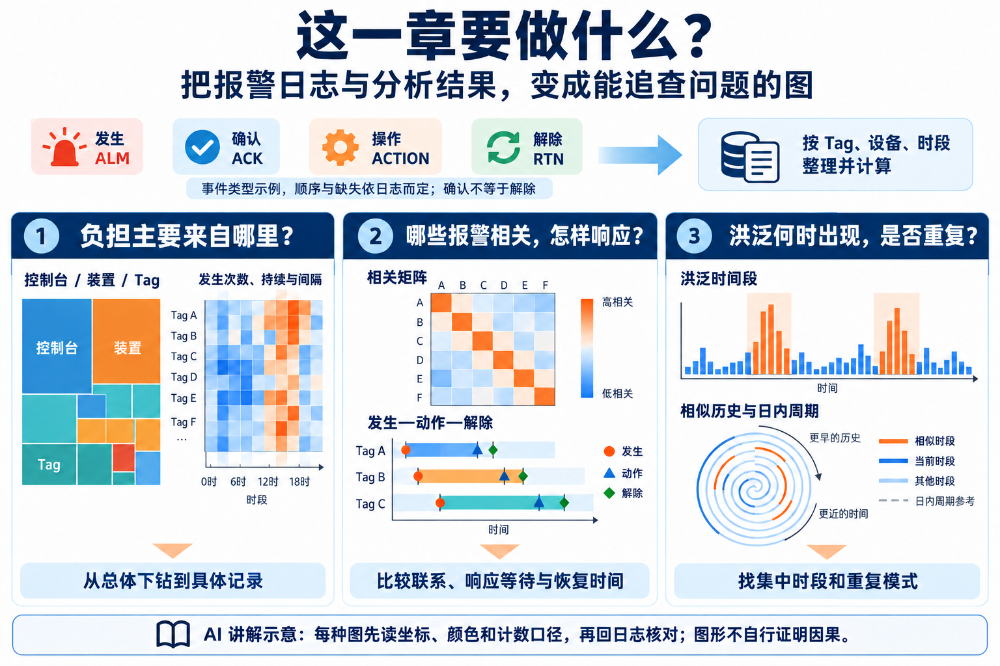
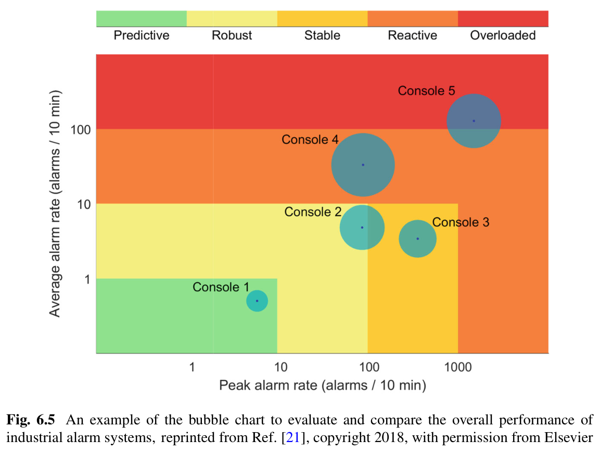
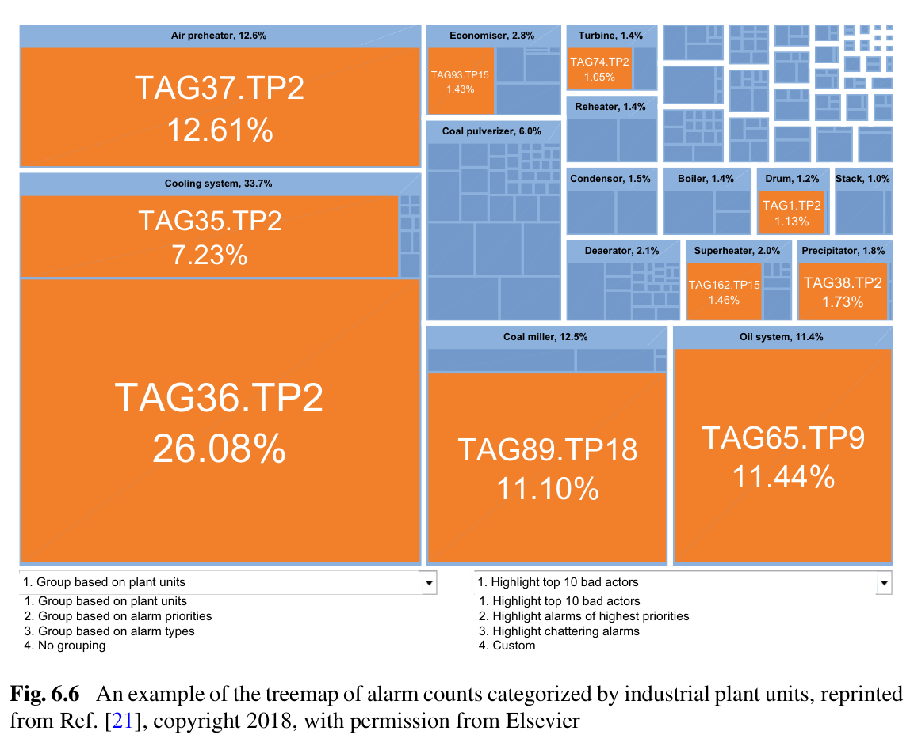
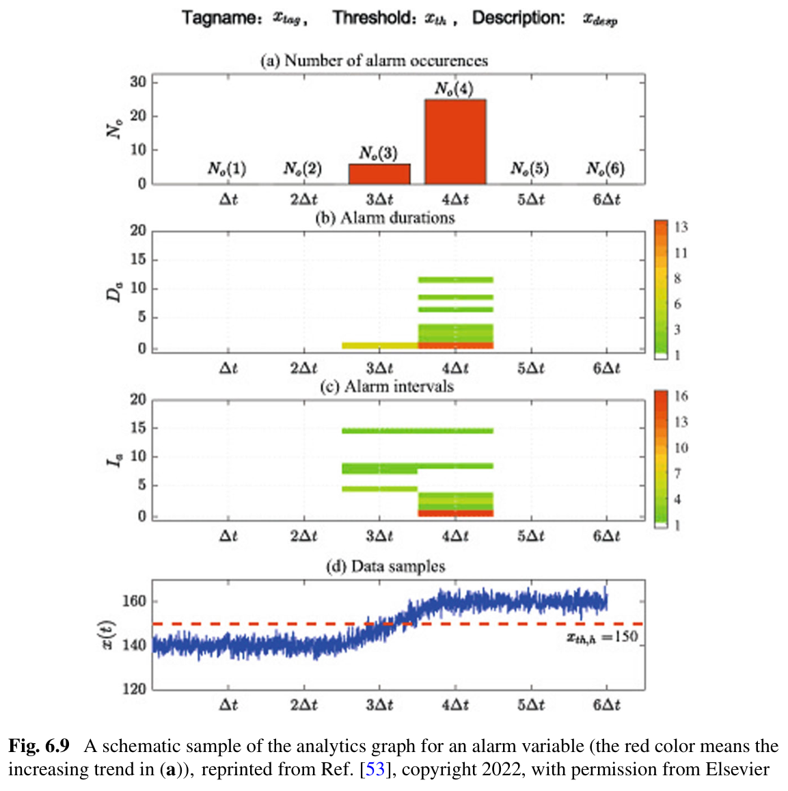
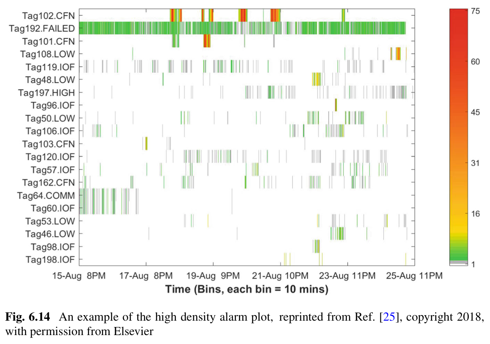
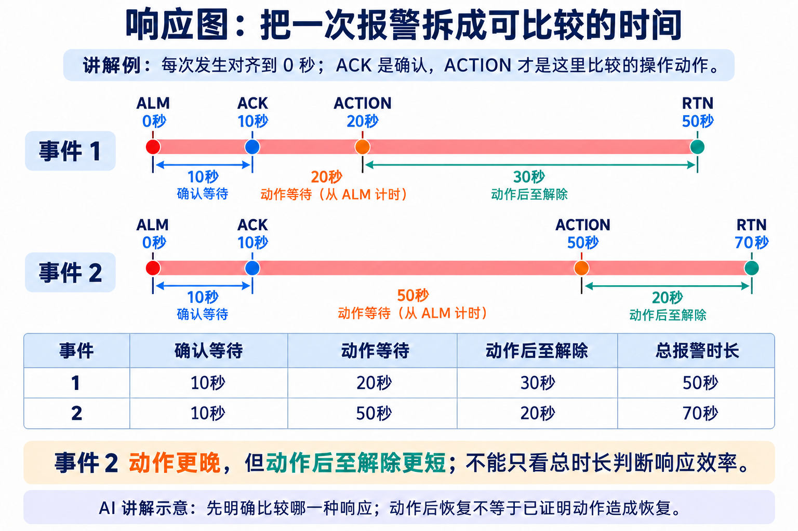
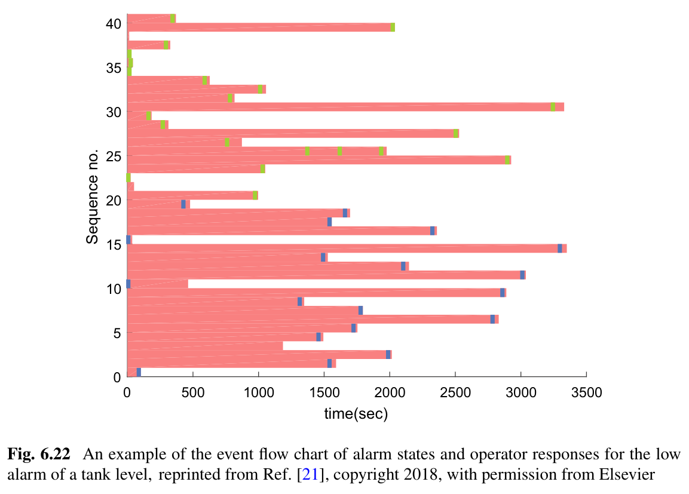
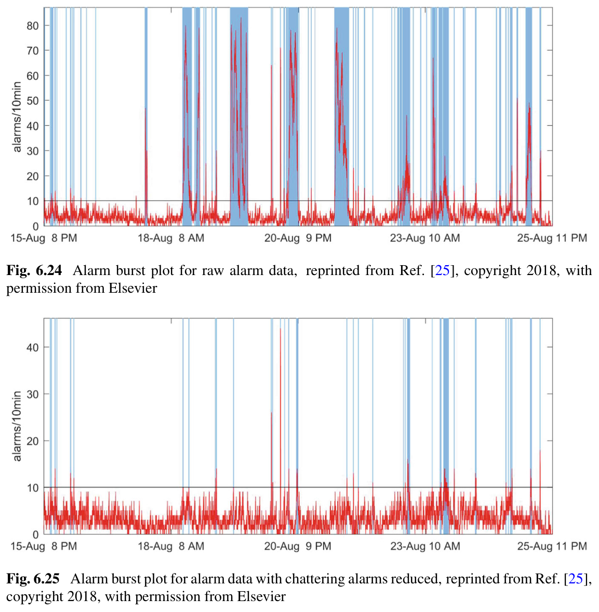
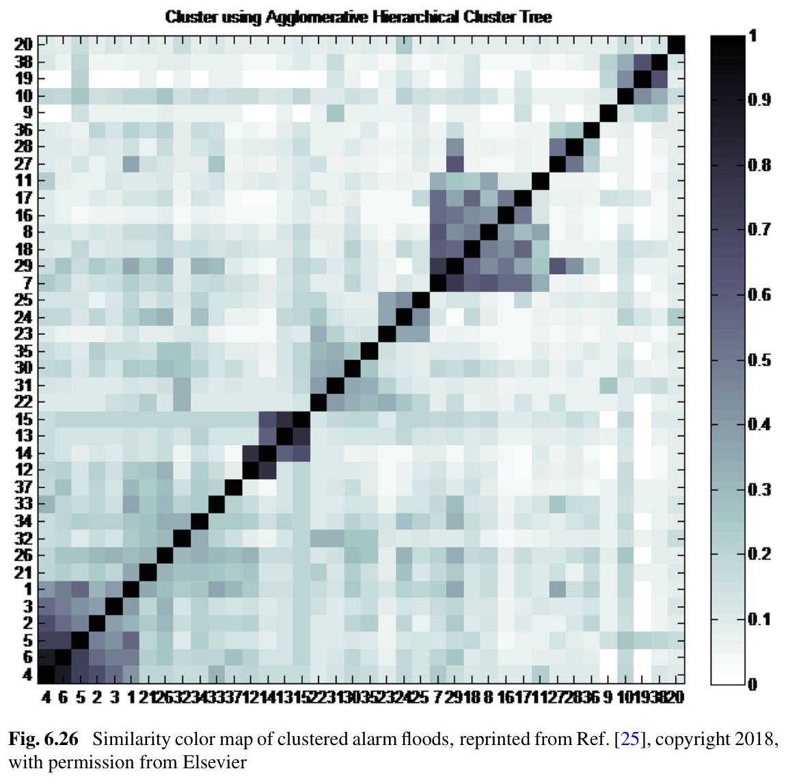
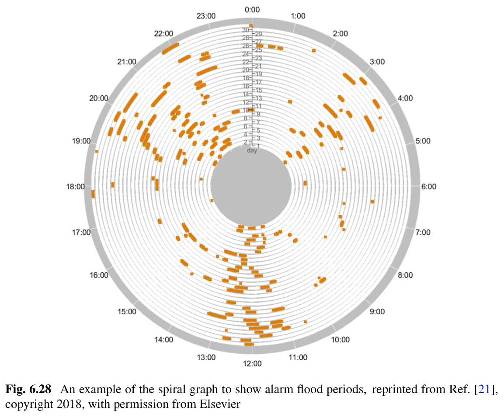

# 第 6 章：怎样把报警数据画成能追查问题的图

原文：[参考 PDF](../references/source.pdf)，书页 381–420，PDF 第 389–428 页。
入口：§6.1 PDF 389；§6.2 PDF 395；§6.3 PDF 412；§6.4 PDF 419。
图片在 `references/figures/6/`，依次为 `1.png` 至 `10.png`；远程预览不显示时可在项目文件树打开。

## 这一章要做什么

**图片 1｜AI 讲解示意，非原书实验结果。** 本章整合已有统计与分析，通过图形找线索，并让用户回到具体记录。

几千支 Tag、几十万条事件不适合逐行看。可视分析的任务是让人先知道**问题集中在哪里，再看何时发生、哪些记录支持判断**。

| 想回答什么 | 先整理什么资料 | 看哪类图 |
|---|---|---|
| 哪个控制台、装置或 Tag 负担大？ | 发生计数、平均与峰值报警率、层级归属 | 气泡图、treemap、排名 |
| 是反复开关，还是长时间不解除？ | 发生/解除配对、持续与间隔 | analytics graph；结合状态检查 |
| 哪些报警相关，怎样响应？ | 同步变量、相关分数、动作记录 | 相关矩阵、workflow、event flow |
| 洪泛何时发生、哪些相似、有何周期？ | 已定义的洪泛段、两两相似分数、时间 | burst、similarity、spiral |

图形显示什么，取决于上游怎样计数、建模。仅有报警负担统计时，不能把“报警多”改名成有异常真值支持的 FAR，也不能把颜色相近直接称为根因相同。

## §6.1：先把发生、确认、动作和解除分清

**A&E（Alarm & Event）日志**不只存报警：还可能包含操作命令、模式变化、确认、恢复等事件。将文本按时间、Tag、事件类型、值和设备信息结构化后，才适合统计和关联（PDF 392–394）。

| 事件或资料 | 能告诉我们什么 | 不能直接替代什么 |
|---|---|---|
| ALM：发生 | 从未报警进入报警的时刻 | 持续期间每个采样点不是新发生 |
| ACK：确认 | 操作员确认看到了报警 | 确认不等于工况恢复 |
| ACTION：操作或命令 | 实际采取了何种记录在案的动作 | 动作并不一定由这次报警引起 |
| RTN：返回正常 / 解除 | 本次报警状态结束 | 没有配对 ALM 时，时长仍不完整 |
| 连续过程值与工艺关系 | 支持解释为什么报警、为什么恢复 | 不能靠事件名称补出所有过程证据 |

本章平台框架（PDF 390–391）可以概括为：**接收资料→统一事件含义→计算统计或关系→选择图形→下钻核对**。跨窗口的未解除报警、缺失记录和重复事件应单独处理，不能为画完整图任意补一个解除时刻。

## §6.2：先看系统负担，再下钻具体 Tag

### 气泡图：平均不忙，是否仍有瞬间过载

先对同一观察期、同一操作员或控制台范围，计算平均报警率、峰值报警率，以及出现过的不同 Tag 数。再用三个视觉通道一起显示：

先用一张小表看清这些量怎样得到。假设同一控制台的 30 分钟日志，按三个不重叠的 10 分钟窗统计 **ALM 发生次数**：

| Tag | 第一个窗 | 第二个窗 | 第三个窗 | 合计 |
|---|---:|---:|---:|---:|
| A | 3 | 6 | 0 | 9 |
| B | 1 | 4 | 1 | 6 |
| C | 0 | 2 | 1 | 3 |
| 总发生次数 | 4 | 12 | 2 | 18 |

由此得到平均 `18/3=6` 次/10 分钟，三个统计窗中的峰值为 12，出现过的不同 Tag 为 3。**18、12、3 各有含义**：总负担、集中程度、涉及范围，不能互换。实际若按滑动窗求峰值，应重新扫描日志，并保持各控制台使用相同口径。

**图片 2｜原书 Fig. 6.5，PDF 396（书页 388）。** 按图上的轴标读：横轴峰值、纵轴平均值，单位都是每 10 分钟报警数；气泡面积表达不同报警的数量。

| 看哪里 | 意味着什么 |
|---|---|
| 越往右 | 最忙时的峰值越高 |
| 越往上 | 平时平均负担越高 |
| 气泡面积越大 | 涉及的不同报警更多，不是发生次数必然更多 |
| 中心所在的背景分区 | 按原书引用的性能分区判断负担水平，不能按气泡跨过的边缘判区 |

例如图中 Console 1 在左下，Console 4、5 在右上：后两者不只是涉及 Tag 多，平均与峰值负担也更高。图上有变换后的刻度，不能按屏幕距离当作线性倍数；数量若翻倍，翻倍的是气泡面积，不是半径。

原文文字与式 6.1 的横纵轴顺序不一致；这里按 Fig. 6.5 的轴标解释。背景分区沿用书中引用资料，并不代替现场任务的验收定义。

### Treemap：负担到底集中在哪个装置、哪些 Tag

**Treemap（矩形树图）**把全部发生次数分到矩形面积中，再按装置→Tag 等层级细分。面积来自统计，颜色可另标优先级或重点项；先看图例，不能默认颜色越红就是越异常。

**图片 3｜原书 Fig. 6.6，PDF 398（书页 390）。** 冷却系统占大块，内部 TAG36.TP2 又占显著份额；橙色在本图用于突出 Top bad actors，不是异常概率。

使用时沿着“大块装置→内部大块 Tag→该 Tag 的时间记录”下钻。份额必须说明分母：占整个工厂 20%，与占该装置 20%，是两回事。只看比例也不够，整厂报警减少时，某 Tag 比例上升未必意味着其次数增加。

沿用上表，若装置甲包含 A、B，装置乙只有 C：甲占 `15/18=83.3%`，是优先排查的大块；A 占全控制台 `9/18=50%`，占甲内部却是 `9/15=60%`。下钻到 A 后，应看它的六次发生为何集中在第二窗，而不是仅凭 50% 就调整阈值。

### Analytics graph：同样很忙，是抖动还是滞留

**图片 4｜原书 Fig. 6.9，PDF 401（书页 393）。** 同一 Tag 的四种视图，共用观察时段。

| 图中位置 | 怎样读 |
|---|---|
| (a) 发生次数柱 | 看哪个时段反复 0→1；红色表示较前一段增加，不表示该段已确认故障 |
| (b) 持续时间分布 | 纵轴是一次报警持续多久，颜色表示这种时长的频数 |
| (c) 非报警间隔分布 | 看解除之后多久又发生；短持续、短间隔反复出现提示抖动 |
| (d) 原始过程与阈值 | 回看是否在阈值附近往返，或过程本身发生了较大变化 |

长时间保持报警可能只发生一次；高发生次数则常来自反复开关。对多 Tag 集合，书中还分别数“曾经处于报警的变量”“本期新出现变量”“全期滞留变量”“总发生次数”（PDF 402），不能用一个总数代替四种情况。

例如某 Tag 的局部日志为 `ALM(10s)→RTN(12s)→ALM(14s)→RTN(16s)`：两次持续时间各 2 秒，中间非报警间隔也为 2 秒。它会在发生次数上增加 2，并在短持续、短间隔处留下记录；再看过程曲线是否反复跨过阈值，才能判断该优先检查死区/延时，还是确有频繁过程变化。

这就是四图联看的作用：次数指出“忙”，持续与间隔指出“怎样忙”，过程曲线提供调整报警机制所需的依据。单看次数下降，无法知道是抖动减少，还是报警一直不解除。

### HDAP：多支 Tag 在什么时候一起变忙

**HDAP（高密度报警图）**先按发生次数选出需要展示的 Tag，再把时间切成小格，统计每个“Tag×时间格”的发生次数，映射为颜色。

**图片 5｜原书 Fig. 6.14，PDF 409（书页 401）。** 横轴时间，每格 10 分钟；纵轴 Tag；颜色表示该格发生次数，红橙比绿色多。

- **同一行反复出现热色**：该 Tag 在多个时段频繁触发，值得检查重复或抖动。
- **某个时刻多行同时有色**：多支 Tag 集中发生，值得下钻该时段的事件和过程。
- **长横带不直接等于一直未解除**：这是发生计数图；真正连续保持报警而没有新发生的 Tag，需从状态和持续时长判断。

原图 Tag192.FAILED 一行长期反复活动，Tag102.CFN 有局部高频；这些是负担线索，不自动证明传感器损坏或应删除报警。

开头的三 Tag 计数表本身就是一张最小 HDAP 的数据底稿：把 A 行第二窗的 6 映射为较热颜色，C 行的 0、2、1 映射为较冷颜色。多行在第二窗同时变热，就回查该窗的事件次序与过程。只展示 Top 20 时还应保留全量入口：低频但重要的 Tag 可能没有进入这张图。

### 其他几种图怎样选

| 图形 | 看什么、为什么用它 | 原文位置 |
|---|---|---|
| Top bad actor 排名 | 比较两个时期各 Tag 次数和排名，追踪整治后谁下降、谁新上榜；先固定范围与时间长度 | PDF 403–404 |
| 分层报警计数雷达 | 每个位置是一支 Tag；内层看本期次数，外层看较前期增减，适合同时扫很多 Tag | PDF 404–406 |
| 多层性能比较雷达 | 每个扇区是一项指标，以参照标记比较本期与前期；持续、次数、响应等先按各自尺度处理 | PDF 405–408 |
| 动态 3D 柱图 | 把 Tag、时间、次数放在一起并动态排序，用于观察近期集中增长；旋转或排序后仍需知道同一柱对应谁 | PDF 410–412 |

雷达图中不同指标可能“越大越好”或“越大越差”，不能只比面积。原书对缩放的文字与式 6.10 也不完全一致，需精确重建时回 PDF 406 核对，不把示意布局当成计算定义。

例如整治前 A、B 分别发生 100、80 次，整治后变成 20、30 次：B 排名从第二变第一，但它也减少了 50 次。排名图要同时保留次数；分层计数雷达中，B 的当前次数为 30、前后变化为 −50，也不能把“当前第一”读成“整治后恶化”。比较期长度不同，则先换成相同时间下的发生率。

## §6.3：相关报警与操作响应，图是怎样得来的

### 相关矩阵与工作流回答不同问题

| 图形 | 数据怎样变成图 | 能作出的判断 |
|---|---|---|
| Correlation color map | 先选相关度量，逐对计算；连续曲线可看共同振荡，报警状态可用对应二值度量，再聚类重排 | 深色块提示一组相关变量；自相关通常最高，非对角块才是重点 |
| Response workflow | 从日志提取发生、恢复及动作，按依赖分析组织为节点与边 | 看常见处置路径、重复回路、是否缺少已记录响应 |

相关图的行列是同一组变量，颜色是**选定度量的结果**，不是屏幕直接“看出来”的因果。工作流里三角形表示报警发生/恢复，椭圆表示动作；箭头表示事件依赖，空心/实心区分独特与重复事件。具体符号见 PDF 415–417。

若日志里只看到确认、没记录实际操作，就不能据此宣布“没有处置”；若有动作后解除，也不能仅凭先后顺序认定动作是恢复的唯一原因。

原书的具体例子（PDF 416–417）是：同一变量触发低、低低、极低报警，操作员通过两种命令之一打开 V2 阀，低报警随后解除；另一些报警则在修改限值后解除。工作流把这些常见路径汇总出来，提醒我们**同样显示“解除”，背后的操作可能不同**。

可沿图追问：通常先做哪个命令？是否来回重复？解除前是否改过限值？再回看对应日志核实。书中此处主要介绍可视表达和已有流程挖掘结果，未在本章完整推导依赖挖掘算法；不能把“将每对相邻事件连起来”当成作者完整方法。

### Event flow：把多次发生到解除的过程放在同一时间尺上

**图片 6｜AI 讲解示意。** 两次报警按发生时刻对齐；动作等待从 ALM 开始，不是从 ACK 开始。

一个完整操作链是（PDF 417–419）：

1. 对同一 Tag 配对每次发生与解除，形成一个报警区间；一行表示一次区间。
2. 在区间内找相关动作，并保留动作名称及相对时刻。
3. 将各行按发生、动作或解除等选定事件对齐，比较等待和恢复；图中要明确对齐参考。
4. 需要概括时聚合同类响应；聚合高度可表达出现频数，宽度表达相应时间间隔。

讲解例：发生为 0 秒，确认 10 秒，操作 20 秒，解除 50 秒，则确认等待 10 秒、动作等待 20 秒、动作后至解除 30 秒，总报警时长 50 秒。把 ACK 当 RTN，就会把 50 秒误算成 10 秒。

图中第二次若操作在 50 秒、解除在 70 秒，则两次可分开比较：

| 次数 | 从 ALM 等到动作 | 动作后至 RTN | 总时长 |
|---|---:|---:|---:|
| 第一次 | 20 秒 | 30 秒 | 50 秒 |
| 第二次 | 50 秒 | 20 秒 | 70 秒 |

第二次总时长更长，主要差在动作前多等了 30 秒，动作后反而少了 10 秒。若只按“70 秒比 50 秒长”评价操作效果，就混淆了响应等待与响应后的过程；图上分别对齐 ALM 和动作，正是为了分清这两部分。

**图片 7｜原书 Fig. 6.22，PDF 418（书页 410）。** 每行不是一支不同 Tag，而是同一水箱低水位报警的一次发生—解除区间；横轴为相对秒数，红条长短表示持续时间，绿/蓝短线表示两类供水泵响应。

应比较红条中“动作之前有多长”和“动作之后还要多久才解除”。相邻两行在图上靠近，不代表它们在日历时间上连续；原始发生日期仍需保留。

## §6.4：洪泛何时出现、哪些相似、是否按周期重复

### Burst plot：先从发生次数得到洪泛状态

**Burst alarm rate** 是滑动窗口内的发生事件数。根据定义的开始、结束阈值维护洪泛状态，再将状态覆盖到时间曲线上；它不是持续报警采样点之和。

**图片 8｜原书 Fig. 6.24–6.25，PDF 421（书页 413）。** 红线为每 10 分钟发生数，黑线为开始阈值 10，蓝色覆盖洪泛段；上下图纵轴范围不同，不能直接按峰高像素比较效果。

书中以达到 10 进入、降到 5 以下退出；中间区域保持此前状态，避免一条阈值附近反复切换（PDF 420）。这与 Chapter 5 按新关注 Tag 集合计数的 C 判据不同，要先选清口径。

假设起初不在洪泛，连续检查得到下表；数值均为各时刻**向前回看 10 分钟**的发生次数，不是累计总数：

| 发生数依次变化 | 9 | 10 | 7 | 5 | 4 |
|---|---|---|---|---|---|
| 洪泛状态 | 0 | 1 | 1 | 1 | 0 |

10 时进入，降到 7 或恰好 5 时继续保持，4 时才退出。因此蓝色覆盖不是简单把所有“高于 10”的曲线点涂色。开头计数表第二窗有 12 次发生、只涉及 3 支 Tag，也说明发生计数达到门槛，与 10 支不同 Tag 带来的新负担是不同判据。

原书用 40 秒延时处理后的图中峰值和洪泛占时减少，这是该例的负担变化。**图本身没有验证真实异常是否漏掉、报警是否过晚**，不能据此直接称配置已安全最优。

### Similarity map：颜色来自序列对齐分数

**图片 9｜原书 Fig. 6.26，PDF 423（书页 415）。** 两轴都是洪泛编号，不是 Tag 或日期刻度；重排后编号不按时间顺序排列。

先按 [Chapter 5](ch05-alarm-floods.md) 等方法算每两段洪泛的相似分数，再映射颜色。相同编号与自身比较为 1；原图纵轴显示顺序与横轴相反，故最深的自身匹配线从左下走向右上。围绕它的深色块表示一群相似历史，应沿编号回查对应事件，而不是称深色块已经代表同一故障。

聚类只改变排列以便观察，不会凭空提高相似度。不同分数定义、归一化或事件预处理会改变颜色和分组，跨实验不能只比较“谁的图更成块”。

例如三个洪泛 F1、F2、F3 的归一化相似度依次为 `s12=0.9、s13=0.1、s23=0.2`，把 F1、F2 放到相邻行列，就能看到一个深色小块，提示先一起回查这两次。这里假定分数已经按所选方法归一化到 0–1；第 5 章例子中的 11、12 等原始对齐分，不能直接当作这张图的颜色值。本章展示统一矩阵形式，具体归一化仍依赖选用的序列方法。

### Spiral：把多日记录按“哪一天、一天几点”同时排列

**图片 10｜原书 Fig. 6.28，PDF 425（书页 417）。** 由内向外按天、顺时针按一天时刻排列；顶部为 0 点，下方为 12 点，橙色段表示处于洪泛期。

一圈设为一天：同一天沿一圈看前后变化，同一时刻沿相同角度跨圈比较。若很多圈都在 12 点附近有橙色，就表示不同天的中午反复发生洪泛，值得对照班次、操作和工况记录。

这里颜色画的是已计算的洪泛指示；另一种螺旋图可画发生率，须读各自图例。圈数不是故障次数，周期聚集也不是班次操作造成故障的证据。

## 实际查阅时怎样选

先定一个问题，再取相应范围和口径：用气泡图看总体，用 treemap/排名找来源，用 analytics/HDAP 看 Tag 与时段，再带着原始记录看响应、相似与周期。每次下钻保留 Tag、时间、分母和过滤规则，图之间才能对应。

基本事件对象见 [第 1 章](ch01-overview.md)，误报漏报与延迟设计见 [第 2 章](ch02-univariate-alarm-design.md)，根因方法见 [第 4 章](ch04-root-cause-analysis.md)。
