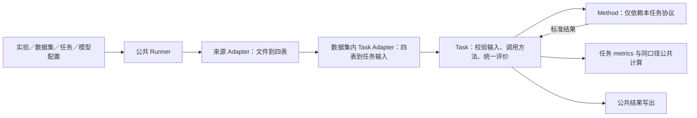

# IIA Benchmark Simplified：公共框架与任务接口设计草案

状态：实现对照版，2026-10-18。T1—T6 已实现并通过对应审查；接口精确字段以所链 contracts.py 为准，运行与扩展命令见 README。

本文说明公共数据格式、模块接口与依赖边界。

## 目标与边界

本仓库提供 Benchmark 脚本、数据／任务／方法约定与统一评测能力。

从实验配置启动，以同一条主链路运行两个任务：首版用火电压差检查单变量报警优化，用 TEP 马氏距离检查联合异常检测与交接接口。两个实例用于检验框架合理性，不以检测效果最优作为首轮目标。PRONTO、SKAB 和未来紫金数据按相同约定后续接入，两类任务不能互换数据集充当验证。

```text
实验配置 → 解析 dataset / task / model；由 dataset + task 找到已登记的转换配置
         → Dataset Adapter → 四表 DatasetBundle
         → 该数据集的 Task Adapter → 对应 Task 的标准输入
         → Task（调用对应 Method → 评价预测）
         → TaskResult（预测 + 该任务的指标）→ 结果文件
```

- `univariate_detection`（单变量报警优化）：选定测点与报警方向；给定原有报警规则时回放基线，并在离线设计数据中搜索阈值、延时、死区的组合，在独立数据上比较。固定参数也是同一规则方法的一种配置。
- `multivariate_detection`（联合异常检测）：选定工艺变量组及工况，学习正常状态，输出该组是否异常；不区分异常类别。
- 根因分析、报警洪泛、可视化、旧入口兼容和 DAM 服务部署不进入本独立仓库的首轮实现。
- 四张现场表到接入文件的转换暂不实现；Benchmark 侧保留读取转换后数据的 Adapter 入口。

**公共数据格式只表达四类数据事实。**它对应数据契约的四张逻辑表：过程值、现有报警设置、变量分组、工况及事件。各时段的实验用途、目标测点或变量组及对齐规则由数据集下对应 Task 的转换配置给出，不进入公共数据对象；来源审计写入结果文件，也不作为第五张业务表。

## 模块边界


| 软件责任 | 维护位置与对外约定 | 交接给贡献者的内容 |
|---|---|---|
| 公共执行与实验记录 | `runner.py`、`config/`、`results/`；只组织标准入口，不认识具体来源或算法私有步骤 | 一份可运行的 experiment、三类引用配置、输出与快照说明 |
| 来源适配 | `data/datasets/<dataset>/bundle.py` 与 dataset 配置；向外提供四表 Bundle | 原始文件说明、字段／质量／时间映射、来源标签依据及转换样例 |
| 数据集到任务转换 | 同一数据集下 `task_adapters/` 及配置；只向所属 Task 提供标准输入 | 支持的组合、目标／分组、用途划分与连续性规则，不重读来源文件 |
| 任务协议与评分 | `tasks/<task>/contracts.py`、`task.py`、`metrics.py`；统一输入、方法结果及评分口径 | 输入输出字段、允许缺省项、有效评价材料与可手算的评分样例 |
| 方法贡献 | `tasks/<task>/methods/`、模型配置及工厂登记；只依赖所属 Task 的方法协议 | 一个真实默认方法及独立替代样例，说明拟合／设计、冻结与预测的调用约定 |




图表示运行与职责边界；具体依赖中，Method 可以使用所属任务的协议和共用数值函数，不反向读取数据 Adapter 或调用 Task 完成私有算法步骤。

正常扩展的改动范围如下，供接手者和阶段审查者共同核对：

| 要接续的工作 | 正常增加／维护 | 应保持稳定 |
|---|---|---|
| 支持已有任务的新数据 | 来源 Adapter、数据集内的 Task Adapter、配置与登记 | Runner、已有 Method 和任务指标定义 |
| 已有任务的新方法 | Method 实现、模型配置、方法工厂登记及行为验证 | 数据读取、任务转换、Task 评分和公共结果写出 |
| 新任务 | 该任务的协议、实现、方法接口与评分，以及实际支持的数据集转换 | 复用公共调度与记录，不要求已有数据集自动支持 |
| 修改评分口径 | 显式调整该 Task 的协议及共用计算，说明已有结果的可比性 | 不把协议变化藏在某个 Method 的内部评分中 |

接手者应能按已有配置从数据准备走到结果核对，并找到上述扩展入口。只有目录整齐或两条实验跑通不足以验收；还需观察扩展实际改动是否遵守这些边界。默认方法可以选择性复用旧数值代码，但其私有逻辑不能成为公共 Task 的隐含前提。

## 目标文件树

在本独立仓库新建 `configs/` 和 `src/iia_benchmark/`。以下是两类任务需要的代码与配置；旧仓库只作为读取和数值实现的参考，不作为运行依赖。

```text
configs/
├── experiments/                  # 一次实验引用 dataset / task / model
│   ├── power_plant_pressure_univariate.json
│   └── tep_multivariate.json
├── datasets/                     # 每个数据集包含四表转换和支持的 Task 转换
│   ├── power_plant/
│   │   ├── dataset.json
│   │   └── task_adapters/univariate_detection.json
│   └── tep/
│       ├── dataset.json
│       └── task_adapters/multivariate_detection.json
├── tasks/                        # 任务类型及评价约定；不重复列指标
│   ├── univariate_detection.json
│   └── multivariate_detection.json
└── models/                       # 方法名及参数；算法代码放在所属 Task 内

src/iia_benchmark/
├── runner.py                     # 实验入口；加载引用、分派 Task、写结果
├── config/loader.py              # 配置读取、引用解析、兼容性检查
├── data/
│   ├── contracts.py              # DatasetBundle：任务无关的四表事实
│   ├── registry.py               # 显式登记 Bundle Adapter 与数据集内 Task Adapter
│   ├── common/                   # 存在实际复用时再提取连续段、对齐等工具
│   └── datasets/
│       ├── power_plant/
│       │   ├── bundle.py          # MAT → 完整四表
│       │   └── task_adapters/
│       │       └── univariate.py # 四表 → UnivariateTaskInput
│       └── tep/
│           ├── bundle.py          # TEP → 完整四表
│           └── task_adapters/
│               └── multivariate.py # 四表 → MultivariateTaskInput
├── tasks/
│   ├── base.py                   # BaseTask：Runner 可调用的共同入口
│   ├── factory.py                # task kind → 具体 Task
│   ├── univariate/
│   │   ├── contracts.py          # 任务输入、标准预测、固定结果类型
│   │   ├── task.py               # 校验任务输入、调用方法、评价预测
│   │   ├── metrics.py            # 本任务的指标口径与结果组装
│   │   └── methods/
│   │       ├── base.py           # UnivariateMethod 抽象接口
│   │       ├── factory.py        # model.method → 本任务的方法实现
│   │       ├── threshold_rule.py # 阈值 + 延时 + 死区的完整固定规则
│   │       └── non_iid_search.py # 方法内统计参考与有界搜索，复用规则预测
│   └── multivariate/
│       ├── contracts.py          # 组输入、标准预测、固定结果类型
│       ├── task.py               # 校验任务输入、调用方法、评价预测
│       ├── metrics.py            # 本任务的指标口径与结果组装
│       └── methods/
│           ├── base.py           # MultivariateMethod 抽象接口
│           ├── factory.py
│           └── mahalanobis.py    # 首个可替换的联合检测方法
├── evaluation/
│   ├── binary.py                 # 仅复用同口径的逐点混淆矩阵计算
│   └── events.py                 # 按 run 提取/匹配事件和计算延迟
└── results/writer.py             # 保存配置、预测、指标与来源记录
```

`threshold_rule.py` 是完整固定规则方法；`non_iid_search.py` 是在同一任务协议下内部构造统计参考并设计的完整方法，复用前者的规则计算函数。阈值、延时、死区是它的可组合参数，不分别作为三种异常检测方法。每个 Method 实现所属 Task 的抽象接口；工厂按 `model.method` 构造实现，Method 本身不实现工厂方法。以后接入另一种完整算法，在所属 Task 的 `methods/` 中实现接口、加入工厂并提供 model 配置，不改 Dataset Adapter 或该 Task 的指标定义。

每个 `datasets/<id>/dataset.json` 用 `adapter` 和 `adapter_config` 说明原始文件、字段、时间、质量、已有报警设置及来源标签如何变成完整四表；`task_adapters` 只登记本数据集支持的 Task 类型及其转换配置路径。转换配置位于同一数据集目录下，规定该 Task 的目标、设计/拟合/校准/评价时段和数据整理规则。配置中的原始数据路径相对项目根目录，`task_adapters` 中的配置路径相对 `dataset.json`。`data.registry` 把配置里的 Adapter ID 映射到显式实现，Runner 不直接拼 Python 模块名。Runner 通过实验引用的 dataset 与 task kind 查找并校验这一登记项，将解析后的转换配置一并写入结果快照；没有登记就明确报不支持。只为实际支持的数据集—Task 组合登记转换；相同处理可复用 `data/common/`，无须按所有数据集与任务的笛卡尔积写代码。首版每个组合只登记一份转换配置，不增设独立的 `configs/splits/` 或顶层 `configs/task_adapters/`。

## Adapter 输出的标准数据格式

`DatasetBundle` 是各来源 Adapter 的共同输出，顶层**只有四个字段**，名称与 09-02 数据契约的四张逻辑表一致：

| 字段 | 内容 |
|---|---|
| `process_values` | `timestamp, run_id, tag_id, value, quality_flag`；按原始采样保留时间和值，包括无效点及其质量标记，不预先拼成 `N×D`。 |
| `tag_alarm_settings` | Tag 元数据和现有阈值、方向、延时、死区；来源没有现有设置时为空表。 |
| `variable_groups` | 组与成员 Tag 的关系；来源没有预声明组时为空表。 |
| `status_events` | 工况、可信正常区间及可选事件/来源标签；缺少相应记录时为空表，不编造确认事故。 |

```text
DatasetBundle(
    process_values=...,
    tag_alarm_settings=...,
    variable_groups=...,
    status_events=...,
)
```

设计/拟合、校准、评价的用途划分留在 `datasets/<id>/task_adapters/<task>.json`；数据集的 Task Adapter 按 Bundle 中的 run ID、时间或采样序号验证边界，输出该 Task 的标准输入。来源文件、校验值、四表转换版本及 Task Adapter 配置写入运行结果的 `manifest.json`，都不是 DatasetBundle 的第五个字段。

这些是四类逻辑数据，不要求公开数据真的存在四个 CSV 文件；TEP、PRONTO、SKAB 和火电压差的 Adapter 只填来源实际具备的表/行。Adapter 做字段、时间及质量语义转换，不为凑齐指标生成异常标签。每张表的行可以由类定义语义，但大时序的内存表示不必强制为每点一个 Python 对象。火电文件已复制至 `data/raw/power_plant/Data_20101.mat`；TEP、PRONTO、SKAB 也已在 `data/raw/` 整理；TEP与火电两层Adapter已实现，PRONTO/SKAB仅准备了数据。

火电压差 Example 3 是单个 Tag `X71NAO067` 的时序，已有高报警阈值为 150 Pa、采样周期 1 秒；原论文示例只验证固定阈值下的 Delay 设计。阈值×Delay 联合搜索使用 Pettitt+t 检验建立正常/异常统计代理，**不是**原始数据自带的异常真值，也不是论文原设定复现。该数据可以根据统计归类的数据段计算 FAR/MAR 等有相应依据的指标，报告必须保留统计依据；不因缺少现场事故标签而一概跳过评价，也不把统计归类称作现场确认事故。F1/ADD 是否可计算由任务口径及可用材料决定。TEP、PRONTO、SKAB 的过程级标签不能直接当成单测点异常真值，本轮只实现 TEP 联合检测，后两者留待扩展。


来源明确标为未知的参考必须保留，不能在转换时丢为无参考。`status_events` 的可选 `event_kind` 只取 reference/operating_mode：前者可携带 -1未知，后者仅表达工况。缺省kind时，state=-1且有operating_mode视为工况事实，无mode则是显式未知参考。Task 对外部参考对象整段优先，不用Method统计代理填补其中未知点。

### 数据集到 Task 的标准输入

每个 Task 在自己的 `contracts.py` 中定义输入类型；每个数据集在 `task_adapters/` 中实现已登记的转换。两类输入都保留 `run_id`、时间、源行对应关系和连续段边界，使预测能够回写、报警状态不会跨无效点或 run 延续。 `source_indices` 指选中Tag／变量组在用途划分前、未删除无效点的时间轴采样位置；TEP/MAT即原始样本序号。异步来源以目标测点并集对齐，无关Tag不能改变缺测或连续性判断；run、时间和列名共同对应四表来源事实。数据集的 Task Adapter 只接收四表 Bundle 与本组合的转换配置；来源文件已由 `bundle.py` 读取，它不再读取 MAT、CSV 等原始文件，也不拟合模型或计算最终指标。

| Task 输入 | 必需内容 | 允许缺失并明确记录 |
|---|---|---|
| `UnivariateTaskInput` | 目标报警通道（Tag、工况、方向）；一维连续设计段和评价段；已有阈值及来源。 | 原有 Delay/Deadband、设计段参考、评价段独立异常真值；回放缺少的原有参数需要明示假设。 |
| `MultivariateTaskInput` | 目标变量组与固定列序；对齐后的正常拟合段和待检测评价段；拟合段正常依据。 | 独立正常校准段、评价段异常真值；具体 Method 若要求校准段，由 Task 在调用前验证。 |

已知正常、已知异常与未知必须区分；没有标签不能默认为正常。标签还需保留来源及作用范围，例如 TEP 的过程级故障不等于组内每个测点的独立故障。Task Adapter 整理可用的参考和评价依据，Task 保管评价真值，向 Method 仅传递设计/拟合允许的信息与无真值的评价视图。方法内部特有的标准化和特征构造由 Method 自己完成。旧仓库的 `ProcessSeries(N×D)` 可作为任务内矩阵输入的参考，不是四表输出或本仓库已有实现。

**火电压差这条单变量链路。**`power_plant/bundle.py` 读取 MAT 中的 `A`，以采样序号对应的相对秒数生成同一 `run_id` 下的 `process_values`；9 个哨兵值仍保留并标成无效。已有高限 150 Pa 成为 `tag_alarm_settings` 的一行；没有提供的 Delay/Deadband 保持缺失，不冒充现场配置。`variable_groups` 为空；联合搜索没有独立异常真值，`status_events` 不由 Adapter 伪造事故。`power_plant/task_adapters/univariate.py` 根据组合配置选 `X71NAO067`，把 `[0,484975)` 作为设计段、`[484984,2678400)` 作为评价段，遇无效点断开连续段，并输出 `UnivariateTaskInput`。需要 Pettitt+t 统计处理的 Method 根据模型配置自行执行；普通固定规则及其他方法不默认执行。候选方法仅用设计段进行配置的参数搜索，冻结后回放评价段；Task 根据标准结果及评价材料统一评分，不读取方法私有对象。相对固定 150 Pa 即时阈值规则统计报警事件变化时，必须把“即时”作为明确的基线假设，而不是现场原有 Delay；统计依据写入报告，FAR/MAR 等由 Task 按约定口径计算；材料不足的指标说明原因，不预先把所有指标留空。

**TEP 这条联合检测链路。**`tep/bundle.py` 将 TEP 文件中的每列展开为 `process_values` 行；`tag_alarm_settings` 为空，预先声明的四测点组进入 `variable_groups`；d00、d00_te 的来源正常区间和 d01_te 从第 160 个采样点起的来源故障区间进入 `status_events`，后者不能写成现场确认事故。`tep/task_adapters/multivariate.py` 根据组合配置选组，按时间对齐成 `N×4`，把 d00、d00_te、d01_te 分别整理为正常拟合、正常校准和评价段，输出 `MultivariateTaskInput`。马氏距离 Method 拟合、校准阈值并对评价段输出逐点分数和异常状态；Task 再用来源故障区间形成评价真值，计算 F1、FAR、MAR、ADD。它们是相对 TEP **过程级故障标签**的指标，不能称为该四测点组的独立故障真值；标签不进入 Method 的拟合或阈值校准。

## 每层对外提供什么

| 层 | 对外接口（概念） | 内部负责 |
|---|---|---|
| `config` | `load_experiment(path) → ExperimentPlan` | 读取实验名和 dataset、task、model 三个引用；按 dataset 的登记表解析并校验 Task Adapter；校验 task 与 method 的匹配关系；保留全部配置快照。 |
| `data.datasets.<id>.bundle` | `load_bundle(adapter_config) → DatasetBundle` | 读取具体来源并翻译为四张逻辑表；保留 run、时间、质量、已有规则、变量组和来源标签。 |
| `data.contracts` | `DatasetBundle` | 仅定义四表的任务无关数据表示；不承载划分、来源审计、预测或训练/评价角色。 |
| `data.registry` | `get_bundle_adapter(id)`、`get_task_adapter(id)` | 将配置 ID 映射到已登记实现，并核对目标 Task 输入类型；Runner 不按文件名动态导入代码。 |
| `data.datasets.<id>.task_adapters.<task>` | `prepare(bundle, adapter_config) → 该 Task 的标准输入` | 按已登记的组合配置选目标、验证划分、处理质量/连续性/对齐并标明参考依据；不读原始文件、不拟合方法。 |
| `tasks.factory` | `create_task(task_spec.kind) → BaseTask` | 根据实验引用的 task 配置创建单变量或联合检测 Task；`BaseTask.run(...) → TaskResult` 是 Runner 唯一依赖的任务入口。 |
| `tasks.univariate` | `run(UnivariateTaskInput, task_spec, model_spec) → TaskResult` | 校验单变量任务前提及基线语义；通过本任务的方法工厂创建 Method、调用预测并按本任务口径评价。 |
| `tasks.multivariate` | `run(MultivariateTaskInput, task_spec, model_spec) → TaskResult` | 校验正常拟合/校准和标签作用范围；调用方法；计算本任务指标并返回。 |
| 各 Task 的 `methods.factory` | `create_method(model_spec) → 该 Task 的 Method 抽象类型` | 校验方法属于此任务，并按配置构造实现；工厂负责选择，不承载算法。 |
| 各 Task 的 `methods` | 实现所属 Task 的抽象接口，返回该 Task 的标准预测 | 自己的拟合、设计、参数搜索和预测；算法特有的数据变换封装在方法内部，不读原始数据路径或计算最终报告指标。 |
| `evaluation` | 逐点计数、事件提取/匹配等纯函数 | 只复用已确认口径相同的计算；不决定标签来源、指标可用性或 Task 的最终报告字段。 |
| `results.writer` | `write(TaskResult, ExperimentPlan)` | 按运行日期、实验名和唯一运行 ID 创建目录；保存预测、参数、指标可用性和数据/配置来源。 |

这里的共同入口是 `BaseTask.run`；两类 Task **不强行共用同一个输入对象、Method 抽象类或训练步骤**。数据集侧 Task Adapter 负责将同一个四表协议转换为各 Task 自己定义的输入类型；Task 无须知道 MAT/TEP 文件布局。工厂与抽象接口各有职责：工厂解决“配置选哪个实现”，抽象类约束“该实现接收什么、返回什么”。Runner 只知道标准转换入口、Task 入口及结果。

### Task 与 Method 之间的约定

```text
单变量数据集 Task Adapter：DatasetBundle + 组合转换配置
  → UnivariateTaskInput（目标、连续设计/评价段、已有规则、参考及其可用性）
单变量 Task：UnivariateTaskInput + Task 配置 + Model 配置
  → UnivariateDesignView（仅设计段可用的参考；评价真值留在 Task）
  → 本 Task 的工厂创建 UnivariateMethod
  → UnivariateMethod.design(设计视图) → 冻结方法状态/报警规则
  → UnivariateMethod.predict(无真值的评价视图) → UnivariatePrediction
  → 单变量 Task 评价预测并输出 TaskResult

联合检测数据集 Task Adapter：DatasetBundle + 组合转换配置
  → MultivariateTaskInput（固定变量组、正常拟合/可选校准段、评价段及参考）
联合检测 Task：MultivariateTaskInput + Task 配置 + Model 配置
  → MultivariateTrainingView（不含评价真值的正常拟合段、可用校准段）
  → 本 Task 的工厂创建 MultivariateMethod
  → MultivariateMethod.fit(正常拟合段、正常校准段) → 冻结检测器
  → MultivariateMethod.predict(无真值的评价矩阵) → MultivariatePrediction
  → 联合检测 Task 评价预测并输出 TaskResult
```

两个抽象接口可以先按以下最小签名落地；`design` / `fit` 会改变方法实例的已拟合状态，调用后方可 `predict`，因此无须每个实现再暴露一个“工厂方法”：

```python
class UnivariateMethod(ABC):
    @abstractmethod
    def design(self, data: UnivariateDesignView) -> None: ...

    @abstractmethod
    def predict(self, data: UnivariateEvaluationView) -> UnivariatePrediction: ...

class MultivariateMethod(ABC):
    @abstractmethod
    def fit(self, data: MultivariateTrainingView) -> None: ...

    @abstractmethod
    def predict(self, data: MultivariateEvaluationView) -> MultivariatePrediction: ...
```

两类 Prediction 都包含按输入连续段排列的 `detections`；每个 `Detection` 必有 `run_id、timestamps[N]、state[N]`，可带 `score[N]`。单变量另有 `selected_parameters` 与可选公开统计参考；联合检测另有 `parameters`。判定界限属于参数信息。每个标准预测都要验证长度、时间顺序及 run 对应关系；分数不是所有方法的必需输出。Method 可以提供参数和诊断信息，但不输出自己定义的最终 F1/FAR 等报告指标。Task 对所有同类方法提供相同的**任务数据语义**，特定方法需要的标准化、统计量或内部特征由该方法完成。评价标签由 Task 留到评测阶段，不随评价输入送给方法。单变量的当前规则可以由同一 `threshold_rule` 方法以固定参数回放，候选规则只在设计段搜索。

### 指标的共用边界

单变量 Task 的固定结果字段是 F1、ADD、MAR、FAR 和报警压缩率；联合检测 Task 的固定结果字段是 F1、ADD、MAR、FAR。Task 自己确定评价标签的来源、作用范围、有效点及 run/事件边界；各 Task 的 `metrics.py` 调用 `evaluation/binary.py` 或 `evaluation/events.py` 的纯函数，组装约定的结果。`configs/tasks/` 不重复列指标清单，也无须为新 Pipeline 设置独立的 `configs/metrics/`。

只有**定义、分母、时间单位和事件匹配规则完全相同**的指标才共用底层函数。例如两个任务都采用逐点 F1，可复用一次混淆矩阵实现；若一个 FAR 是正常采样点中的误报比例，另一个是按正常时段计的误报事件率，必须分别命名和实现，不能因缩写相同就合并。ADD 要明确事件起点、跨 run 边界及未检出事件的处理。单变量报警压缩率由其 Task 比较基线与候选的报警事件数，联合检测无此必填字段。

结果中的每个固定字段要么有数值及口径信息，要么明确 `unavailable` 及原因，不把缺失写成零。火电依据 Pettitt+t 等统计归类计算指标时，在固定报告中明确记录参考来源及口径，不混称现场事故真值，也不由 Method 临时定义另一套最终评分。TEP 标签的作用范围写明为过程级故障。Method 调参只使用设计／拟合／校准段允许的信息，外部评价真值由 Task 保管至预测完成。

## 实验配置如何启动这条链路

实验配置只写实验名，以及对 `datasets / tasks / models` 三类配置的引用；它自己构成第四类。Runner 从 dataset 的 `task_adapters[task.kind]` 解析该数据集到该 Task 的转换配置，路径相对 `dataset.json` 所在目录，不靠文件名猜测，也不要求实验配置重复写第四个引用。Task 配置只写该任务通用的处理/评价参数，Model 配置写算法与搜索参数；数据集—Task 组合特有的目标、时段用途和整理规则写在组合转换配置。下面的 JSON 与已实现配置一致。Loader 检查引用和身份，Runner 在读来源前通过 Task/Method 工厂及 Adapter 登记校验实现兼容性。

`configs/experiments/power_plant_pressure_univariate.json`：

```json
{
  "name": "power_plant_pressure_univariate",
  "dataset": "configs/datasets/power_plant/dataset.json",
  "task": "configs/tasks/univariate_detection.json",
  "model": "configs/models/non_iid_threshold_delay_search.json"
}
```

`configs/datasets/power_plant/dataset.json`：

```json
{
  "id": "power_plant",
  "adapter": "power_plant.bundle",
  "adapter_config": {
    "path": "data/raw/power_plant/Data_20101.mat",
    "variable": "A",
    "run_id": "example3",
    "tag_id": "X71NAO067",
    "sample_period_seconds": 1,
    "alarm_setting": {"direction": "high", "threshold": 150.0},
    "invalid_below": -1000.0
  },
  "task_adapters": {"univariate_detection": "task_adapters/univariate_detection.json"}
}
```

`configs/datasets/power_plant/task_adapters/univariate_detection.json`：

```json
{
  "dataset_id": "power_plant",
  "task_kind": "univariate_detection",
  "adapter": "power_plant.univariate",
  "adapter_config": {
    "tag_id": "X71NAO067",
    "direction": "high",
    "roles": {
      "design": {"run_id": "example3", "start_index": 0, "stop_index": 484975},
      "evaluation": {"run_id": "example3", "start_index": 484984, "stop_index": 2678400}
    },
    "invalid_policy": "break_continuity",
    "minimum_segment_samples": 3600,
    "maximum_gap_seconds": 1,
    "baseline_replay": "declared_instant_threshold_assumption"
  }
}
```

Runner 应校验转换配置的 `dataset_id` 和 `task_kind` 与实验所选配置一致，并验证目标 Tag、run 和索引确实存在。`baseline_replay` 明确说明本示例用已有 150 Pa 阈值构造即时报警比较基线；它不声称来源给过原始 Delay/Deadband。

`configs/tasks/univariate_detection.json`：

```json
{"kind": "univariate_detection", "parameters": {"event_merge_gap_samples": 0}}
```

`configs/models/non_iid_threshold_delay_search.json`：

```json
{
  "method": "non_iid_threshold_delay_search",
  "parameters": {
    "thresholds": [142.5, 150.0, 157.5],
    "delay_samples": [1, 4, 16, 64],
    "deadbands": [0.0, 1.0, 2.0],
    "minimum_segment_samples": 3600,
    "pettitt_alpha": 0.05,
    "ttest_beta": 0.05,
    "target_normal_event_tail": 0.05,
    "target_abnormal_gap_tail": 0.05,
    "normal_weight": 0.5,
    "confidence": 0.95
  }
}
```

规则已固定：高报警触发用包含等值的比较，恢复用严格比较，低报警镜像；死区位置通过 onset_shift/recovery_shift 明示，延时以秒从首个连续合格观测开始，断段重置。统计搜索以有界样本延时候选换算秒数，方法内完成 Pettitt/t 检验及游程尾部目标；它不保证 Task 的逐点指标达到目标。完整模型示例的高 FAR 限制见 README，不作为优化成功。

TEP 的实验也只引用三份配置，Dataset Adapter 保留 52 个原始变量并把预声明的四测点组写入 `variable_groups`。以下两个 JSON 与紧随其后的组合转换配置配套；d01_te 从第 160 个采样点起的来源故障标签由 TEP 的 `bundle.py` 转成四表事件，不写在转换配置中当成划分规则。

`configs/experiments/tep_multivariate.json`：

```json
{
  "name": "tep_multivariate",
  "dataset": "configs/datasets/tep/dataset.json",
  "task": "configs/tasks/multivariate_detection.json",
  "model": "configs/models/mahalanobis.json"
}
```

`configs/datasets/tep/dataset.json`：

```json
{
  "id": "tep",
  "adapter": "tep.bundle",
  "adapter_config": {
    "sample_period_seconds": 180,
    "runs": [
      {"run_id": "d00", "path": "data/raw/tep/data/d00.dat", "source_status": "normal"},
      {"run_id": "d00_te", "path": "data/raw/tep/data/d00_te.dat", "source_status": "normal"},
      {"run_id": "d01_te", "path": "data/raw/tep/data/d01_te.dat", "fault_start_zero_based": 160, "label_scope": "process"}
    ],
    "variable_groups": [{"group_id": "tep_feed", "tag_ids": ["XMEAS_01", "XMEAS_02", "XMEAS_03", "XMEAS_04"]}]
  },
  "task_adapters": {"multivariate_detection": "task_adapters/multivariate_detection.json"}
}
```

`configs/datasets/tep/task_adapters/multivariate_detection.json`：

```json
{
  "dataset_id": "tep",
  "task_kind": "multivariate_detection",
  "adapter": "tep.multivariate",
  "adapter_config": {
    "group_id": "tep_feed",
    "roles": {"fit": ["d00"], "calibration": ["d00_te"], "evaluation": ["d01_te"]},
    "alignment": {"mode": "exact_timestamp", "missing": "reject", "maximum_gap_seconds": 180}
  }
}
```

以 TEP 的四测点马氏距离实验为例，**Runner 的实际调用顺序**是：

| 步骤 | 输入 | 输出与下一步 |
|---|---|---|
| 配置加载 | `configs/experiments/tep_multivariate.json` | 实验名及 dataset、task、model 三份引用；由 dataset 的登记表找到 TEP→联合检测转换配置，校验数据集、任务和方法兼容性。 |
| Dataset Adapter | TEP `dataset.json` 的 `adapter_config`，含 d00/d00_te/d01_te 文件、180 秒采样周期、预声明测点组及来源故障事件 | 四表 `DatasetBundle`；三份文件共 `125840` 条过程值逻辑记录（`(500+960+960)×52`），不先选成四列。 |
| TEP→联合检测 Adapter | Bundle、TEP 的 `task_adapters/multivariate_detection.json` | 取四测点组并按 run 和时间对齐，得到 `MultivariateTaskInput`：`fit[500,4]`、`calibration[960,4]`、`evaluation[960,4]`，保留评价标签及其过程级作用范围。 |
| Task | `MultivariateTaskInput`、task/model 配置 | 校验输入，向 Method 提供无评价真值的矩阵视图；评价标签由 Task 留待预测完成后使用。 |
| Method | 无评价真值的三个矩阵及 model 参数 | 拟合正常模型、独立正常段校准、对评价段返回 `abnormal_state[960]`，可选 `score[960]`。 |
| Task 评价 | 标准预测、Task 保管的过程级标签、时间及 run 边界 | 返回固定指标及标签范围、指标可用性；预测与指标组成 `TaskResult`。 |
| Runner 写出 | `TaskResult` 和配置/数据来源 | 日期/实验名/唯一运行号下的配置快照、预测、指标、来源记录。 |

单变量火电实验复用同一外层调用。其 Task Adapter 只整理已有数据与现有报警设置；如选用的方法需要统计分段，由 Method 内部生成。Task 使用标准方法结果和协议约定的评价材料计算指标，外部评价真值不进入调参；可算与不可算项目均说明依据。

火电 Bundle Adapter 把现有报警设置转换为 `tag_alarm_settings` 的一行；其单变量 Task Adapter 按组合配置取得目标 Tag 和现有阈值。TEP 联合检测的 `variable_groups` 来源可在 TEP 的 `adapter_config` 内预声明；紫金现场数据到来后则由其 Bundle Adapter 读取 `variable_groups.csv`。各数据集的联合检测 Task Adapter 只消费四表，不关心这些组最初来自内嵌列表还是文件。固定指标、不可用指标的原因和输出路径由 Task / Runner 管理，不再进入实验配置。

输出位置遵循统一默认约定：Runner 使用项目时区（当前为 Asia/Shanghai）的运行日期，将 `name` 与日期组成可读运行名；默认根目录为 `experiments/runs/`，生成 `experiments/runs/YYYY-MM-DD/<name>/<HHMMSS-唯一后缀>/`。例如同一天两次执行上面的实验会得到两个独立目录：

```text
experiments/runs/2026-10-18/power_plant_pressure_univariate/
├── 093012-a1b2c3/
│   ├── manifest.json         # 完整运行 ID、时间、数据/配置来源
│   ├── config.snapshot.json  # 本次解析后的 dataset/组合转换/task/model 配置
│   ├── metrics.json
│   └── predictions.csv
└── 104521-d4e5f6/
```

`name` 只写稳定的实验名；日期由 Runner 生成，避免下次运行时忘记改日期。Runner 创建新目录，不覆盖已有结果。普通实验无须配置输出路径；需要将结果放到其他磁盘时，由可选的 `--output-root` 覆盖默认根目录，并将实际路径记录在 `manifest.json`。这不改变 experiment JSON 的职责。

因此，新增数据集需要生成四表的 Bundle Adapter、dataset 配置，以及它实际支持的各 Task 的转换实现和组合配置；新增检测方法主要增加该 Task 内的 Method 和 model 配置；新增任务需要定义其标准输入、预测约定与指标输出，已有数据集要支持这个新 Task 时再登记相应转换。

本仓库只实现上述三引用实验格式，不读取旧 `system/split/metrics/outputs` 入口，也不迁入旧任务盘点文件。两类 Task 通过各自的任务配置选择；用途划分在数据集内的 Task Adapter 配置中，来源故障起点在 Bundle 的来源事件中，两者不混用。

## 现有素材与迁移边界

新仓库已独立实现两条链路；旧工作树的来源读取、报警规则、统计设计曾作为只读数值参考，旧配置、旧 Task 与调用关系不作为新接口的默认实现。迁移后必须能只依赖本仓库运行，保留文献与数据来源，并经所属任务的标准输入输出验证。

火电 MAT 和 TEP DAT 的新路径已在上文示例给出；实际来源与校验值见 `data/manifest.json`。第一轮实现单变量 `threshold_rule`／`non_iid_threshold_delay_search` 与联合检测 `mahalanobis`，PRONTO、SKAB 暂只准备数据，不声称已实现 Adapter 或实验。

## 实施时落实的行为协议

文件树与 JSON 对应当前实现。TEP 需在所属数据转换与任务中落实时间对齐、缺失规则、事件边界和未检出 ADD 的处理；火电需在具体 Method 中落实比较符号、延时／死区状态、统计处理与搜索目标，并由 Task 固定最终评分口径。四表保留来源时间语义及采样依据，不把相对采样时间伪写成绝对现场时间。

方法生成且统一评价确实需要的统计分段等信息，须通过该 Task 的标准结果协议表达，字段语义明确；它不是新增评分层，也不要求其他方法执行相同算法。精确字段在对应任务落地时核对，不允许 Task 读取某个 Method 的私有实现来完成评分。

默认小型测试与显式真实数据验收的命令见 README。交接时须同时提供实际配置、运行命令、结果说明和数据／方法／任务扩展改动示例，不能把文档或测试成功当作已经证明接口合理。
